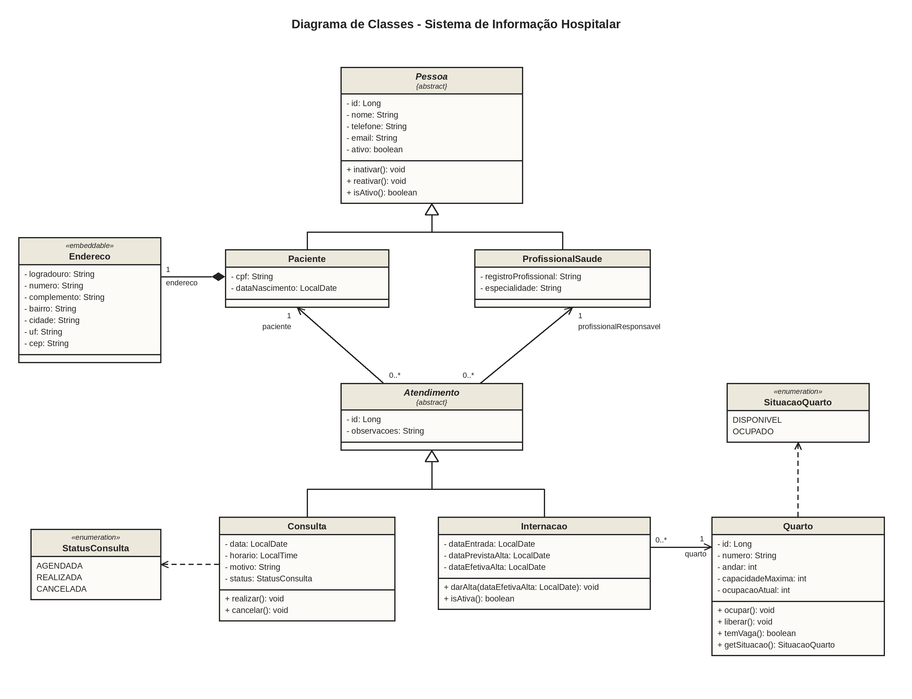

# Sistema de Informação Hospitalar

Sistema web para gestão hospitalar: pacientes, profissionais de saúde (clínicos gerais, médicos
especialistas e cirurgiões), quartos, consultas, internações, atendimentos de emergência,
procedimentos cirúrgicos e histórico médico. O back-end é uma API REST documentada com Swagger e o
front-end é composto por páginas estáticas servidas pela própria aplicação. Trabalho prático da
disciplina de Programação Modular (PUC Minas).

## Sprint 1

Entregas da Sprint 1: protótipo navegável do front-end (telas sem funcionalidade), diagrama de
classes e cartões CRC.

### Telas do protótipo

As telas ficam em `src/main/resources/static/`. Os formulários e botões de ação ainda não
enviam dados; ao usá-los, o protótipo mostra um aviso.

| Tela | Arquivo | Conteúdo |
|------|---------|----------|
| Painel | `index.html` | Resumo do dia, próximas consultas e atalhos |
| Pacientes | `pacientes.html` | Listagem e cadastro de pacientes |
| Profissionais | `profissionais.html` | Listagem e cadastro de profissionais de saúde |
| Consultas | `consultas.html` | Agenda por profissional e data, agendamento de consultas |
| Internações | `internacoes.html` | Internações em andamento, nova internação e registro de alta |
| Quartos | `quartos.html` | Ocupação, situação e cadastro de quartos |
| Histórico médico | `historico.html` | Consultas e internações de um paciente em ordem cronológica |

Com a aplicação rodando, o protótipo abre em `http://localhost:8080`. Também é possível abrir
os arquivos HTML diretamente no navegador, sem subir a aplicação.

### Documentação de modelagem

- [Diagrama de classes](docs/diagrama-de-classes.png)
- [Cartões CRC](docs/cartoes-crc.pdf)



## Sprint 2

Entregas da Sprint 2: modelo de domínio completo com as regras de negócio, persistência no PostgreSQL,
API REST com os endpoints de todos os recursos e diagrama de classes atualizado.

### O que foi implementado

- **Categorias de profissionais.** `ProfissionalSaude` é abstrata, com três categorias: clínico geral,
  médico especialista (com área de atuação) e cirurgião (com área cirúrgica). A listagem por área traz
  especialistas e cirurgiões daquela área. Só o especialista da área realiza consulta especializada, e só
  o cirurgião realiza procedimentos.
- **Modalidades de atendimento.** `Atendimento` é abstrata, com as modalidades consulta de rotina,
  consulta especializada, internação, atendimento de emergência e procedimento cirúrgico. Todas validam
  paciente e profissional ativos antes da realização (padrão Template Method), e cada uma acrescenta as
  suas regras.
- **Situações.** Consultas, emergências e procedimentos seguem máquinas de estados:
  - Consulta: `AGENDADA -> CONFIRMADA -> EM_ATENDIMENTO -> CONCLUIDA`; agendada ou confirmada pode ser
    cancelada ou ter o não comparecimento registrado. Remarcar significa agendar uma nova consulta. As
    observações só podem ser registradas durante o atendimento ou depois da conclusão.
  - Emergência: `AGUARDANDO_AVALIACAO -> EM_ATENDIMENTO -> CONCLUIDO`, com fila por prioridade
    (crítica, alta, moderada, baixa) e ordem de chegada.
  - Procedimento: `AGENDADO -> EM_ANDAMENTO -> CONCLUIDO`, ou `AGENDADO -> CANCELADO`.
- **Procedimentos cirúrgicos.** Exigem um cirurgião ativo, descrição, tipo de cirurgia (eletiva, urgência
  ou emergência) e data e hora prevista. Não podem ser concluídos sem ter sido iniciados, e o fim não
  pode ser anterior ao início. Há observações pré-operatórias e pós-operatórias.
- **Tipos de quarto.** Enfermaria (até 6 leitos), apartamento (até 2) e UTI (1). A capacidade é validada
  no cadastro e na alteração do quarto, e a ocupação nunca ultrapassa a capacidade.
- **Outras regras.** Consultas não podem ser agendadas no passado nem se sobrepor a outras consultas
  ativas do profissional ou do paciente (duração configurável em `hospital.consulta.duracao-minutos`,
  padrão de 30 minutos). O paciente não pode ter duas internações ativas. Pacientes e profissionais são
  inativados, nunca excluídos, e não podem ser inativados com atendimentos em andamento. Quarto que já
  recebeu internação não pode ser removido.
- **Histórico médico.** Reúne todos os atendimentos do paciente, de todas as modalidades, em ordem
  cronológica.

### Diagrama de classes

[Diagrama de classes da Sprint 2](docs/diagrama-de-classes.md), em Mermaid: modelo de domínio,
arquitetura em camadas, padrões de projeto e as principais decisões de modelagem.

### Endpoints

Os erros seguem o formato ProblemDetail, com mensagens em português: 400 para dados inválidos (com a
lista dos campos), 404 para recurso não encontrado, 409 para dado já cadastrado ou transição de situação
inválida e 422 para as demais regras de negócio. Cadastros respondem 201 com o cabeçalho `Location`.

| Recurso | Método | Rota | Descrição |
|---------|--------|------|-----------|
| Pacientes | GET | `/pacientes?ativos=` | Lista os pacientes (todos ou só os ativos) |
| | GET | `/pacientes/{id}` | Busca um paciente |
| | POST | `/pacientes` | Cadastra um paciente |
| | PUT | `/pacientes/{id}` | Atualiza os dados de um paciente |
| | PATCH | `/pacientes/{id}/inativar` | Inativa um paciente |
| | PATCH | `/pacientes/{id}/reativar` | Reativa um paciente |
| | GET | `/pacientes/{id}/historico` | Histórico médico do paciente |
| Profissionais | GET | `/profissionais?ativos=&area=` | Lista os profissionais (todos, ativos ou de uma área) |
| | GET | `/profissionais/{id}` | Busca um profissional |
| | POST | `/profissionais` | Cadastra um profissional |
| | PUT | `/profissionais/{id}` | Atualiza nome, telefone e e-mail |
| | PATCH | `/profissionais/{id}/inativar` | Inativa um profissional |
| | PATCH | `/profissionais/{id}/reativar` | Reativa um profissional |
| | GET | `/profissionais/{id}/agenda?data=` | Agenda de consultas do profissional na data |
| | GET | `/profissionais/{id}/procedimentos` | Procedimentos realizados pelo cirurgião |
| Quartos | GET | `/quartos?tipo=&comVaga=` | Lista os quartos (filtros combináveis) |
| | GET | `/quartos/{id}` | Busca um quarto |
| | POST | `/quartos` | Cadastra um quarto |
| | PUT | `/quartos/{id}` | Atualiza um quarto |
| | DELETE | `/quartos/{id}` | Remove um quarto que nunca recebeu internação |
| Consultas | POST | `/consultas/rotina` | Agenda uma consulta de rotina |
| | POST | `/consultas/especializadas` | Agenda uma consulta especializada |
| | GET | `/consultas?situacao=&profissionalId=&data=` | Lista as consultas (filtros combináveis) |
| | GET | `/consultas/{id}` | Busca uma consulta |
| | PATCH | `/consultas/{id}/confirmar` | Confirma uma consulta agendada |
| | PATCH | `/consultas/{id}/iniciar` | Inicia o atendimento de uma consulta confirmada |
| | PATCH | `/consultas/{id}/concluir` | Conclui uma consulta em atendimento |
| | PATCH | `/consultas/{id}/cancelar` | Cancela uma consulta agendada ou confirmada |
| | PATCH | `/consultas/{id}/registrar-nao-comparecimento` | Registra que o paciente não compareceu |
| | PATCH | `/consultas/{id}/registrar-observacoes` | Registra as observações da consulta |
| Internações | POST | `/internacoes` | Interna um paciente |
| | GET | `/internacoes?ativas=` | Lista as internações ativas (padrão) ou as encerradas |
| | GET | `/internacoes/{id}` | Busca uma internação |
| | PATCH | `/internacoes/{id}/registrar-alta` | Registra a alta e libera a vaga do quarto |
| Emergências | POST | `/emergencias` | Registra a chegada de um paciente |
| | GET | `/emergencias/fila` | Fila de quem aguarda avaliação |
| | GET | `/emergencias?situacao=` | Lista os atendimentos de uma situação |
| | GET | `/emergencias/{id}` | Busca um atendimento de emergência |
| | PATCH | `/emergencias/{id}/definir-prioridade` | Define ou reclassifica a prioridade |
| | PATCH | `/emergencias/{id}/iniciar` | Inicia o atendimento |
| | PATCH | `/emergencias/{id}/concluir` | Conclui o atendimento |
| Procedimentos | POST | `/procedimentos` | Agenda um procedimento cirúrgico |
| | GET | `/procedimentos?data=` | Lista os procedimentos previstos para a data |
| | GET | `/procedimentos/{id}` | Busca um procedimento |
| | PATCH | `/procedimentos/{id}/iniciar` | Inicia um procedimento agendado |
| | PATCH | `/procedimentos/{id}/concluir` | Conclui um procedimento em andamento |
| | PATCH | `/procedimentos/{id}/cancelar` | Cancela um procedimento agendado |
| | PATCH | `/procedimentos/{id}/registrar-observacoes-pre-operatorias` | Registra as observações pré-operatórias |
| | PATCH | `/procedimentos/{id}/registrar-observacoes-pos-operatorias` | Registra as observações pós-operatórias |

### Testando pelo Swagger

Com a aplicação rodando, abra http://localhost:8080/swagger-ui.html. Cada operação tem a descrição das
regras e das respostas de erro. Para executar uma chamada, abra a operação, clique em **Try it out**,
preencha os parâmetros ou o corpo e clique em **Execute**. Os ids usados nos passos seguintes vêm das
respostas anteriores (campo `id`); os exemplos abaixo supõem que cada cadastro recebeu o id 1.

1. **Cadastrar um paciente** em `POST /pacientes`:

   ```json
   {
     "nome": "Maria Silva",
     "cpf": "529.982.247-25",
     "dataNascimento": "1990-05-10",
     "email": "maria@email.com"
   }
   ```

2. **Cadastrar um profissional** em `POST /profissionais`. Para médico especialista ou cirurgião,
   informe também `"areaAtuacao"` (por exemplo, `"CARDIOLOGIA"`):

   ```json
   {
     "nome": "Dra. Ana Lima",
     "registroProfissional": "CRM-MG 12345",
     "categoria": "CLINICO_GERAL"
   }
   ```

3. **Agendar uma consulta** em `POST /consultas/rotina`, com data e horário no futuro:

   ```json
   {
     "pacienteId": 1,
     "profissionalId": 1,
     "data": "2030-01-15",
     "horario": "14:00",
     "motivo": "Check-up anual"
   }
   ```

4. **Conduzir a consulta até concluída**, informando o id da consulta em cada operação:
   1. `PATCH /consultas/{id}/confirmar`: a situação passa a `CONFIRMADA`;
   2. `PATCH /consultas/{id}/iniciar`: a situação passa a `EM_ATENDIMENTO`;
   3. `PATCH /consultas/{id}/registrar-observacoes`, com o corpo `{"texto": "Pressão 12x8, sem queixas."}`;
   4. `PATCH /consultas/{id}/concluir`: a situação passa a `CONCLUIDA`.

5. **Conferir o resultado** em `GET /pacientes/{id}/historico`, que mostra a consulta concluída. Para
   ver uma regra em ação, tente `PATCH /consultas/{id}/cancelar` na consulta concluída: a resposta é
   409, com a mensagem de que a situação é final.

## Stack

- HTML, CSS e JavaScript no front-end, sem frameworks
- Java 21 e Spring Boot 4 (Web MVC, Data JPA, Validation)
- PostgreSQL 17 instalado localmente
- Flyway para migrations (schema validado pelo Hibernate com `ddl-auto=validate`)
- springdoc-openapi (Swagger UI), com erros no formato ProblemDetail (RFC 9457)
- JUnit 5, Mockito, AssertJ, Spring MockMvc, H2 (modo PostgreSQL) e JaCoCo
- Maven Wrapper

## Pré-requisitos

- Java 21 (JDK Temurin recomendado)
- PostgreSQL 17 (instalador oficial para Windows)

Não é necessário instalar o Maven: o projeto usa o Maven Wrapper (`mvnw.cmd`).

## Criando o banco de dados

Com o PostgreSQL em execução, crie o banco `hospital` (no PowerShell):

```powershell
& "C:\Program Files\PostgreSQL\17\bin\psql.exe" -h localhost -U postgres -c "CREATE DATABASE hospital"
```

As tabelas são criadas automaticamente pelo Flyway na primeira execução da aplicação.

## Configuração da conexão

A conexão é lida de variáveis de ambiente, com valores padrão para o ambiente local:

| Variável      | Padrão                                     |
|---------------|--------------------------------------------|
| `DB_URL`      | `jdbc:postgresql://localhost:5432/hospital` |
| `DB_USER`     | `postgres`                                 |
| `DB_PASSWORD` | `hospital123`                              |

Para usar outros valores, defina as variáveis antes de iniciar a aplicação:

```powershell
$env:DB_PASSWORD = "minha-senha"
```

## Como rodar no Windows (PowerShell)

```powershell
.\mvnw.cmd spring-boot:run
```

A aplicação sobe em `http://localhost:8080`.

## Documentação da API

- Swagger UI: http://localhost:8080/swagger-ui.html
- OpenAPI (JSON): http://localhost:8080/v3/api-docs

## Testes e cobertura

Os testes usam o perfil `test`, com banco H2 em memória no modo PostgreSQL e as mesmas migrations do
Flyway. Não é preciso ter o PostgreSQL rodando para executá-los.

```powershell
.\mvnw.cmd verify
```

Para rodar só uma classe de teste:

```powershell
.\mvnw.cmd test "-Dtest=ConsultaServiceTest"
```

A suíte cobre:

| Camada | Onde | O que verifica |
|--------|------|----------------|
| Domínio | `src/test/java/.../model` | Regras das entidades, máquinas de estados e Template Method |
| Services | `src/test/java/.../service` | Regras de negócio com Mockito (sobreposição de horários, inativação etc.) |
| Repositories | `src/test/java/.../repository` | Consultas JPQL no H2 (fila da emergência, listagem por área, filtros) |
| Controllers | `src/test/java/.../controller` | Rotas, status, validação e formato dos erros com `@WebMvcTest` |
| Migrations | `MigracaoV3Test`, `MigracaoV4Test` e `MigracaoV6Test` | Conversão dos dados existentes nas migrations que os alteram |
| Integração | `src/test/java/.../FluxoCompletoIntegracaoTest` | Fluxo completo pela API, do cadastro ao histórico |

O relatório de cobertura do JaCoCo é gerado em `target/site/jacoco/index.html`.
