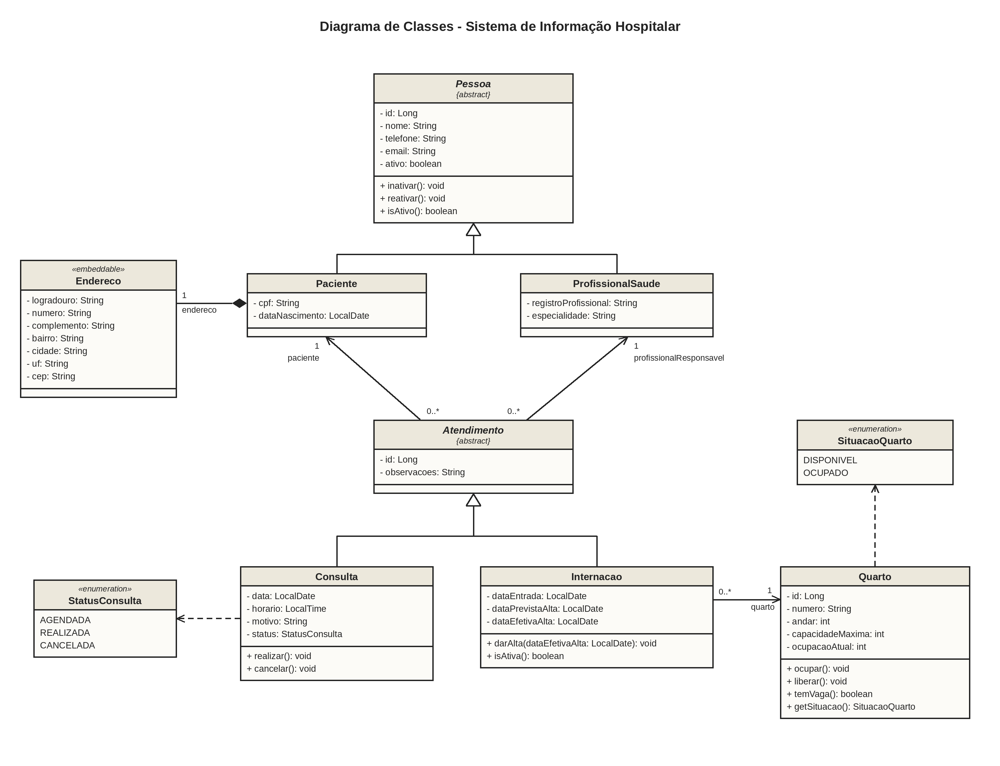

# Sistema de Informação Hospitalar

Sistema web para gestão hospitalar: pacientes, profissionais de saúde (clínicos gerais, médicos
especialistas e cirurgiões), quartos, consultas, internações, atendimentos de emergência,
procedimentos cirúrgicos e histórico médico. O back-end é uma API REST documentada com Swagger e o
front-end é composto por páginas estáticas servidas pela própria aplicação. Trabalho prático da
disciplina de Programação Modular (PUC Minas).

## Sprint 1

Entregas da Sprint 1: protótipo navegável do front-end (telas sem funcionalidade), diagrama de
classes e cartões CRC.

### Telas do protótipo

As telas ficam em `src/main/resources/static/`. Na entrega da Sprint 1, os formulários e botões de ação
ainda não enviavam dados; na Sprint 3, todas as telas passaram a usar a API (veja
[Telas](#telas)).

| Tela | Arquivo | Conteúdo |
|------|---------|----------|
| Painel | `index.html` | Resumo do dia, próximas consultas e atalhos |
| Pacientes | `pacientes.html` | Listagem e cadastro de pacientes |
| Profissionais | `profissionais.html` | Listagem e cadastro de profissionais de saúde |
| Consultas | `consultas.html` | Agenda por profissional e data, agendamento de consultas |
| Internações | `internacoes.html` | Internações em andamento, nova internação e registro de alta |
| Quartos | `quartos.html` | Ocupação, situação e cadastro de quartos |
| Histórico médico | `historico.html` | Consultas e internações de um paciente em ordem cronológica |

Com a aplicação rodando, as telas abrem em `http://localhost:8080`. Como dependem da API, não funcionam
abrindo os arquivos HTML diretamente no navegador.

### Documentação de modelagem

- [Diagrama de classes](docs/diagrama-de-classes.png)
- [Cartões CRC](docs/cartoes-crc.pdf)



## Sprint 2

Entregas da Sprint 2: modelo de domínio completo com as regras de negócio, persistência no PostgreSQL,
API REST com os endpoints de todos os recursos e diagrama de classes atualizado.

### O que foi implementado

- **Categorias de profissionais.** `ProfissionalSaude` é abstrata, com três categorias: clínico geral,
  médico especialista (com área de atuação) e cirurgião (com área cirúrgica). A listagem por área traz
  especialistas e cirurgiões daquela área. Só o especialista da área realiza consulta especializada, e só
  o cirurgião realiza procedimentos.
- **Encaminhamento.** O clínico geral encaminha o paciente para atendimento especializado em uma área,
  registrado na consulta de rotina (`areaEncaminhamento`). Só vale durante o atendimento ou depois da
  conclusão; especialistas, cirurgiões e consultas especializadas não encaminham. Os especialistas da área
  são listados em `GET /profissionais?area=`.
- **Modalidades de atendimento.** `Atendimento` é abstrata, com as modalidades consulta de rotina,
  consulta especializada, internação, atendimento de emergência e procedimento cirúrgico. Todas validam
  paciente e profissional ativos antes da realização (padrão Template Method), e cada uma acrescenta as
  suas regras.
- **Situações.** Consultas, emergências e procedimentos seguem máquinas de estados:
  - Consulta: `AGENDADA -> CONFIRMADA -> EM_ATENDIMENTO -> CONCLUIDA`; agendada ou confirmada pode ser
    cancelada ou ter o não comparecimento registrado. Remarcar significa agendar uma nova consulta. As
    observações só podem ser registradas durante o atendimento ou depois da conclusão.
  - Emergência: `AGUARDANDO_AVALIACAO -> EM_ATENDIMENTO -> CONCLUIDO`, com fila por prioridade
    (crítica, alta, moderada, baixa) e ordem de chegada.
  - Procedimento: `AGENDADO -> EM_ANDAMENTO -> CONCLUIDO`, ou `AGENDADO -> CANCELADO`.
- **Procedimentos cirúrgicos.** Exigem um cirurgião ativo, descrição, tipo de cirurgia (eletiva, urgência
  ou emergência) e data e hora prevista. Não podem ser concluídos sem ter sido iniciados, e o fim não
  pode ser anterior ao início. Há observações pré-operatórias e pós-operatórias.
- **Tipos de quarto.** Enfermaria (até 6 leitos), apartamento (até 2) e UTI (1). A capacidade é validada
  no cadastro e na alteração do quarto, e a ocupação nunca ultrapassa a capacidade.
- **Outras regras.** Consultas não podem ser agendadas no passado nem se sobrepor a outras consultas
  ativas do profissional ou do paciente (duração configurável em `hospital.consulta.duracao-minutos`,
  padrão de 30 minutos). O paciente não pode ter duas internações ativas. Pacientes e profissionais são
  inativados, nunca excluídos, e não podem ser inativados com atendimentos em andamento. Quarto que já
  recebeu internação não pode ser removido.
- **Histórico médico.** Reúne todos os atendimentos do paciente, de todas as modalidades, em ordem
  cronológica.

### Diagrama de classes

O diagrama completo entregue na Sprint 2, com todas as classes num único desenho, está em imagem
([PNG](docs/diagrama-de-classes-sprint2.png) e [SVG](docs/diagrama-de-classes-sprint2.svg)). O documento
[docs/diagrama-de-classes.md](docs/diagrama-de-classes.md), em Mermaid, com o modelo de domínio, a
arquitetura em camadas, os padrões de projeto e as decisões de modelagem, foi atualizado na Sprint 3
(veja [Diagrama de classes da Sprint 3](#diagrama-de-classes-da-sprint-3)).

### Decisões de modelagem

- **Endereço como objeto de valor.** Na conversa em sala sobre o diagrama da Sprint 1, o professor
  questionou se fazia sentido manter uma classe só para o endereço. Analisamos depois e decidimos
  mantê-la, por três motivos: os sete campos do endereço (logradouro, número, complemento, bairro,
  cidade, UF e CEP) sempre andam juntos, e agrupá-los deixa a classe `Paciente` mais coesa; o endereço é
  um objeto de valor, sem identidade própria e que não existe sem o paciente, o que justifica a
  composição; e ele não gera uma tabela separada no banco, porque fica embutido na própria tabela do
  paciente, então organiza o código sem nenhum custo na persistência.

As demais decisões (heranças, padrões de projeto e regras de cada modalidade) estão explicadas na seção
[Decisões de modelagem](docs/diagrama-de-classes.md#10-decisões-de-modelagem) do diagrama de classes.

### Endpoints

Endpoints entregues na Sprint 2. A tabela completa e atualizada, com os da Sprint 3, está em
[Tabela completa de endpoints](#tabela-completa-de-endpoints), e os status de erro, em
[Exceções e status de erro](#exceções-e-status-de-erro). Cadastros respondem 201 com o cabeçalho `Location`.

| Recurso | Método | Rota | Descrição |
|---------|--------|------|-----------|
| Pacientes | GET | `/pacientes?ativos=` | Lista os pacientes (todos ou só os ativos) |
| | GET | `/pacientes/{id}` | Busca um paciente |
| | POST | `/pacientes` | Cadastra um paciente |
| | PUT | `/pacientes/{id}` | Atualiza os dados de um paciente |
| | PATCH | `/pacientes/{id}/inativar` | Inativa um paciente |
| | PATCH | `/pacientes/{id}/reativar` | Reativa um paciente |
| | GET | `/pacientes/{id}/historico` | Histórico médico do paciente |
| Profissionais | GET | `/profissionais?ativos=&area=` | Lista os profissionais (todos, ativos ou de uma área) |
| | GET | `/profissionais/{id}` | Busca um profissional |
| | POST | `/profissionais` | Cadastra um profissional |
| | PUT | `/profissionais/{id}` | Atualiza nome, telefone e e-mail |
| | PATCH | `/profissionais/{id}/inativar` | Inativa um profissional |
| | PATCH | `/profissionais/{id}/reativar` | Reativa um profissional |
| | GET | `/profissionais/{id}/agenda?data=` | Agenda de consultas do profissional na data |
| | GET | `/profissionais/{id}/procedimentos` | Procedimentos realizados pelo cirurgião |
| Quartos | GET | `/quartos?tipo=&comVaga=` | Lista os quartos (filtros combináveis) |
| | GET | `/quartos/{id}` | Busca um quarto |
| | POST | `/quartos` | Cadastra um quarto |
| | PUT | `/quartos/{id}` | Atualiza um quarto |
| | DELETE | `/quartos/{id}` | Remove um quarto que nunca recebeu internação |
| Consultas | POST | `/consultas/rotina` | Agenda uma consulta de rotina |
| | POST | `/consultas/especializadas` | Agenda uma consulta especializada |
| | GET | `/consultas?situacao=&profissionalId=&data=` | Lista as consultas (filtros combináveis) |
| | GET | `/consultas/{id}` | Busca uma consulta |
| | PATCH | `/consultas/{id}/confirmar` | Confirma uma consulta agendada |
| | PATCH | `/consultas/{id}/iniciar` | Inicia o atendimento de uma consulta confirmada |
| | PATCH | `/consultas/{id}/concluir` | Conclui uma consulta em atendimento |
| | PATCH | `/consultas/{id}/cancelar` | Cancela uma consulta agendada ou confirmada |
| | PATCH | `/consultas/{id}/registrar-nao-comparecimento` | Registra que o paciente não compareceu |
| | PATCH | `/consultas/{id}/registrar-observacoes` | Registra as observações da consulta |
| | PATCH | `/consultas/{id}/encaminhar` | Encaminha o paciente para atendimento especializado |
| Internações | POST | `/internacoes` | Interna um paciente |
| | GET | `/internacoes?ativas=` | Lista as internações ativas (padrão) ou as encerradas |
| | GET | `/internacoes/{id}` | Busca uma internação |
| | PATCH | `/internacoes/{id}/registrar-alta` | Registra a alta e libera a vaga do quarto |
| Emergências | POST | `/emergencias` | Registra a chegada de um paciente |
| | GET | `/emergencias/fila` | Fila de quem aguarda avaliação |
| | GET | `/emergencias?situacao=` | Lista os atendimentos de uma situação |
| | GET | `/emergencias/{id}` | Busca um atendimento de emergência |
| | PATCH | `/emergencias/{id}/definir-prioridade` | Define ou reclassifica a prioridade |
| | PATCH | `/emergencias/{id}/iniciar` | Inicia o atendimento |
| | PATCH | `/emergencias/{id}/concluir` | Conclui o atendimento |
| Procedimentos | POST | `/procedimentos` | Agenda um procedimento cirúrgico |
| | GET | `/procedimentos?data=` | Lista os procedimentos previstos para a data |
| | GET | `/procedimentos/{id}` | Busca um procedimento |
| | PATCH | `/procedimentos/{id}/iniciar` | Inicia um procedimento agendado |
| | PATCH | `/procedimentos/{id}/concluir` | Conclui um procedimento em andamento |
| | PATCH | `/procedimentos/{id}/cancelar` | Cancela um procedimento agendado |
| | PATCH | `/procedimentos/{id}/registrar-observacoes-pre-operatorias` | Registra as observações pré-operatórias |
| | PATCH | `/procedimentos/{id}/registrar-observacoes-pos-operatorias` | Registra as observações pós-operatórias |

### Testando pelo Swagger

Com a aplicação rodando, abra http://localhost:8080/swagger-ui.html. Cada operação tem a descrição das
regras e das respostas de erro. Para executar uma chamada, abra a operação, clique em **Try it out**,
preencha os parâmetros ou o corpo e clique em **Execute**. Os ids usados nos passos seguintes vêm das
respostas anteriores (campo `id`); os exemplos abaixo supõem que cada cadastro recebeu o id 1.

1. **Cadastrar um paciente** em `POST /pacientes`:

   ```json
   {
     "nome": "Maria Silva",
     "cpf": "529.982.247-25",
     "dataNascimento": "1990-05-10",
     "email": "maria@email.com"
   }
   ```

2. **Cadastrar um profissional** em `POST /profissionais`. Para médico especialista ou cirurgião,
   informe também `"areaAtuacao"` (por exemplo, `"CARDIOLOGIA"`):

   ```json
   {
     "nome": "Dra. Ana Lima",
     "registroProfissional": "CRM-MG 12345",
     "categoria": "CLINICO_GERAL"
   }
   ```

3. **Agendar uma consulta** em `POST /consultas/rotina`, com data e horário no futuro:

   ```json
   {
     "pacienteId": 1,
     "profissionalId": 1,
     "data": "2030-01-15",
     "horario": "14:00",
     "motivo": "Check-up anual"
   }
   ```

4. **Conduzir a consulta até concluída**, informando o id da consulta em cada operação:
   1. `PATCH /consultas/{id}/confirmar`: a situação passa a `CONFIRMADA`;
   2. `PATCH /consultas/{id}/iniciar`: a situação passa a `EM_ATENDIMENTO`;
   3. `PATCH /consultas/{id}/registrar-observacoes`, com o corpo `{"texto": "Pressão 12x8, sem queixas."}`;
   4. `PATCH /consultas/{id}/concluir`: a situação passa a `CONCLUIDA`.

5. **Conferir o resultado** em `GET /pacientes/{id}/historico`, que mostra a consulta concluída. Para
   ver uma regra em ação, tente `PATCH /consultas/{id}/cancelar` na consulta concluída: a resposta é
   409, com a mensagem de que a situação é final.

## Sprint 3

Entregas da Sprint 3: exceções personalizadas, regras de disponibilidade entre consultas e
procedimentos, sala cirúrgica, filtros, ordenação e indicadores com interfaces funcionais, e todas as
telas integradas à API.

### O que foi implementado

- **Exceções personalizadas.** Todas estendem `RegraNegocioException`. Na Sprint 3 entraram
  `AtendimentoIndisponivelException` (409), `ProfissionalIncompativelException` (422) e
  `QuartoSemVagasException` (409); o status de cada uma está em
  [Exceções e status de erro](#exceções-e-status-de-erro).
- **Disponibilidade e sala cirúrgica.** Consultas e procedimentos não podem ocupar o mesmo período do
  profissional, do paciente ou da sala cirúrgica. A verificação é feita no agendamento, pela interface
  funcional `BuscaDeOcupacoes` e pelo `VerificadorDeDisponibilidade`. A consulta ocupa 30 minutos
  (configuráveis em `hospital.consulta.duracao-minutos`), e o procedimento, a sua duração prevista, de 15 a
  720 minutos. O procedimento exige uma sala cirúrgica ativa; a sala não é excluída, só inativada, e não
  pode ser inativada com procedimento agendado ou em andamento.
- **Filtros, ordenação e indicadores com interfaces funcionais.**
  - `FiltroAtendimentos` monta um único `Predicate` com os filtros informados (paciente, profissional,
    situação, modalidade e período), usado na busca de atendimentos, na listagem de consultas, na agenda
    do profissional e no período dos indicadores.
  - `OrdenacaoAtendimentos` guarda um `Comparator` para cada ordenação (data, data decrescente, paciente e
    prioridade), usado na busca de atendimentos, na fila de emergência e no histórico.
  - Os quatro indicadores de `GET /indicadores` (consultas realizadas, atendimentos por modalidade, quartos
    disponíveis e ocupados e atendimentos por profissional) são contados por um único método,
    `IndicadorService.contar`, que recebe um `Predicate` (o que entra na contagem) e uma `Function` (o
    critério de agrupamento).
  - Os quartos (com vaga e por tipo) e as internações (ativas ou encerradas) também filtram com
    `Predicate`.
- **Situação de qualquer atendimento.** `getSituacao()` passou a existir em todas as modalidades; a da
  internação (`ATIVA` ou `ENCERRADA`) é derivada da data de alta. As respostas de consulta, emergência e
  procedimento informam as próximas situações possíveis e o que pode ser feito agora, como
  `permiteIniciar` e `permiteRegistrarObservacoes`.
- **Domínios.** `GET /dominios` devolve os valores de todos os enums, com a descrição, para as listas de
  opções das telas.
- **Integração das telas.** As onze telas usam a API: cadastros, agenda, emergência, procedimentos,
  internações, histórico, indicadores e um painel com os dados do dia (veja [Telas](#telas)).

### Exceções e status de erro

Os erros seguem o formato ProblemDetail (RFC 9457), com título e mensagem em português.

| Status | Quando |
|--------|--------|
| 400 | Dados inválidos (com a lista `campos`, cada um com campo e mensagem), corpo mal formatado, valor de enum desconhecido, parâmetro de tipo errado ou parâmetro obrigatório ausente |
| 404 | `RecursoNaoEncontradoException` ou endereço inexistente |
| 405 | Método HTTP não permitido na rota |
| 409 | `DadoJaCadastradoException`, `TransicaoSituacaoInvalidaException`, `AtendimentoIndisponivelException`, `QuartoSemVagasException`, violação de integridade no banco (mensagem genérica) e alteração simultânea do mesmo registro |
| 422 | `ProfissionalIncompativelException`, `DataInvalidaException` e as demais `RegraNegocioException` |
| 500 | Qualquer outro erro, com mensagem genérica; o detalhe fica só no log |

### Tabela completa de endpoints

Cadastros respondem 201 com o cabeçalho `Location`; remoções, 204. Mudanças de situação usam `PATCH` em
sub-rotas com o verbo da ação e devolvem o recurso atualizado.

| Recurso | Método | Rota | Descrição |
|---------|--------|------|-----------|
| Pacientes | GET | `/pacientes?ativos=` | Lista os pacientes (todos ou só os ativos) |
| | GET | `/pacientes/{id}` | Busca um paciente |
| | POST | `/pacientes` | Cadastra um paciente |
| | PUT | `/pacientes/{id}` | Atualiza os dados de um paciente (o CPF não muda) |
| | PATCH | `/pacientes/{id}/inativar` | Inativa um paciente sem atendimentos ativos |
| | PATCH | `/pacientes/{id}/reativar` | Reativa um paciente |
| | GET | `/pacientes/{id}/historico` | Histórico médico do paciente |
| Profissionais | GET | `/profissionais?ativos=&area=` | Lista os profissionais (todos, ativos ou de uma área) |
| | GET | `/profissionais/{id}` | Busca um profissional |
| | POST | `/profissionais` | Cadastra um profissional |
| | PUT | `/profissionais/{id}` | Atualiza nome, telefone e e-mail |
| | PATCH | `/profissionais/{id}/inativar` | Inativa um profissional sem atendimentos ativos |
| | PATCH | `/profissionais/{id}/reativar` | Reativa um profissional |
| | GET | `/profissionais/{id}/agenda?data=` | Agenda de consultas do profissional na data |
| | GET | `/profissionais/{id}/procedimentos` | Procedimentos realizados pelo cirurgião |
| Quartos | GET | `/quartos?tipo=&comVaga=` | Lista os quartos (filtros combináveis) |
| | GET | `/quartos/{id}` | Busca um quarto |
| | POST | `/quartos` | Cadastra um quarto |
| | PUT | `/quartos/{id}` | Atualiza número, andar, tipo e capacidade |
| | DELETE | `/quartos/{id}` | Remove um quarto que nunca recebeu internação |
| Salas cirúrgicas | GET | `/salas-cirurgicas?ativas=` | Lista as salas (todas ou só as ativas) |
| | GET | `/salas-cirurgicas/{id}` | Busca uma sala |
| | POST | `/salas-cirurgicas` | Cadastra uma sala |
| | PUT | `/salas-cirurgicas/{id}` | Atualiza a identificação da sala |
| | PATCH | `/salas-cirurgicas/{id}/inativar` | Inativa uma sala sem procedimento ativo |
| | PATCH | `/salas-cirurgicas/{id}/reativar` | Reativa uma sala |
| Consultas | POST | `/consultas/rotina` | Agenda uma consulta de rotina |
| | POST | `/consultas/especializadas` | Agenda uma consulta especializada |
| | GET | `/consultas?situacao=&profissionalId=&data=` | Lista as consultas (filtros combináveis) |
| | GET | `/consultas/{id}` | Busca uma consulta |
| | PATCH | `/consultas/{id}/confirmar` | Confirma uma consulta agendada |
| | PATCH | `/consultas/{id}/iniciar` | Inicia o atendimento de uma consulta confirmada |
| | PATCH | `/consultas/{id}/concluir` | Conclui uma consulta em atendimento |
| | PATCH | `/consultas/{id}/cancelar` | Cancela uma consulta agendada ou confirmada |
| | PATCH | `/consultas/{id}/registrar-nao-comparecimento` | Registra que o paciente não compareceu |
| | PATCH | `/consultas/{id}/registrar-observacoes` | Registra as observações da consulta |
| | PATCH | `/consultas/{id}/encaminhar` | Encaminha o paciente para atendimento especializado |
| Internações | POST | `/internacoes` | Interna um paciente |
| | GET | `/internacoes?ativas=` | Lista as internações ativas (padrão) ou as encerradas |
| | GET | `/internacoes/{id}` | Busca uma internação |
| | PATCH | `/internacoes/{id}/registrar-alta` | Registra a alta e libera a vaga do quarto |
| | PATCH | `/internacoes/{id}/registrar-observacoes` | Registra as observações da internação |
| Emergências | POST | `/emergencias` | Registra a chegada de um paciente |
| | GET | `/emergencias/fila` | Fila de quem aguarda avaliação |
| | GET | `/emergencias?situacao=` | Lista os atendimentos de uma situação |
| | GET | `/emergencias/{id}` | Busca um atendimento de emergência |
| | PATCH | `/emergencias/{id}/definir-prioridade` | Define ou reclassifica a prioridade |
| | PATCH | `/emergencias/{id}/iniciar` | Inicia o atendimento (exige a prioridade definida) |
| | PATCH | `/emergencias/{id}/concluir` | Conclui o atendimento |
| | PATCH | `/emergencias/{id}/registrar-observacoes` | Registra as observações do atendimento |
| Procedimentos | POST | `/procedimentos` | Agenda um procedimento cirúrgico |
| | GET | `/procedimentos?data=` | Lista os procedimentos previstos para a data |
| | GET | `/procedimentos/{id}` | Busca um procedimento |
| | PATCH | `/procedimentos/{id}/iniciar` | Inicia um procedimento agendado |
| | PATCH | `/procedimentos/{id}/concluir` | Conclui um procedimento em andamento |
| | PATCH | `/procedimentos/{id}/cancelar` | Cancela um procedimento agendado |
| | PATCH | `/procedimentos/{id}/registrar-observacoes-pre-operatorias` | Registra as observações pré-operatórias |
| | PATCH | `/procedimentos/{id}/registrar-observacoes-pos-operatorias` | Registra as observações pós-operatórias |
| Atendimentos | GET | `/atendimentos?pacienteId=&profissionalId=&situacao=&modalidade=&inicio=&fim=&ordem=` | Busca atendimentos de todas as modalidades, com filtros combináveis e ordenação |
| Indicadores | GET | `/indicadores?inicio=&fim=` | Consultas realizadas, atendimentos por modalidade e por profissional e quartos disponíveis e ocupados |
| Domínios | GET | `/dominios` | Valores de todos os enums, com a descrição, para as listas de opções das telas |

### Telas

As telas ficam em `src/main/resources/static/` e abrem em `http://localhost:8080` com a aplicação
rodando. São páginas em HTML, CSS e JavaScript sem frameworks; cada tela tem o seu script em `js/`, as
chamadas à API passam por `js/api.js` e os valores dos enums vêm de `GET /dominios`.

| Tela | Arquivo | O que faz |
|------|---------|-----------|
| Painel | `index.html` | Resumo do dia (consultas, internações em andamento, quartos disponíveis, fila de emergência e procedimentos), próximos atendimentos de hoje e atalhos |
| Indicadores | `indicadores.html` | Os quatro indicadores, com período opcional e barras para comparar as quantidades |
| Pacientes | `pacientes.html` | Listagem, cadastro, edição, inativação e reativação de pacientes |
| Profissionais | `profissionais.html` | Listagem com categoria e área, cadastro (a área só aparece nas categorias que a exigem), edição, inativação e reativação |
| Consultas | `consultas.html` | Agenda com filtros, agendamento por modalidade, mudanças de situação, observações e encaminhamento |
| Emergência | `emergencias.html` | Fila de avaliação por prioridade, registro de chegada, triagem, início, conclusão e observações |
| Internações | `internacoes.html` | Internações ativas e encerradas, nova internação em quarto com vaga, alta e observações |
| Procedimentos | `procedimentos.html` | Procedimentos do dia, agendamento com cirurgião e sala, início, conclusão, cancelamento e observações pré e pós-operatórias |
| Quartos | `quartos.html` | Ocupação, filtros por tipo e vaga, cadastro, edição e remoção |
| Salas cirúrgicas | `salas-cirurgicas.html` | Listagem com filtro de ativas, cadastro, edição, inativação e reativação de salas |
| Histórico médico | `historico.html` | Busca do paciente (inclusive inativos) e linha do tempo de todos os atendimentos, com filtros e ordenação |

As telas pedem confirmação antes das ações que não podem ser desfeitas (cancelar, registrar alta,
remover) e, quando a API recusa uma operação, mostram a mensagem dela.

### Decisões de modelagem da Sprint 3

- **Conflito de agenda e de vaga como 409.** Horário ocupado e quarto lotado são conflitos com o estado
  atual do recurso; profissional incompatível é uma regra que a requisição não atende e responde 422.
- **Disponibilidade só no agendamento.** Iniciar um atendimento não verifica a agenda de novo, e emergência
  e internação, que não têm horário marcado, ficam fora. Dois agendamentos simultâneos para o mesmo
  horário não são bloqueados, uma limitação conhecida.
- **Período do procedimento pela previsão.** A agenda usa sempre a data e hora prevista mais a duração
  prevista, mesmo depois que o procedimento começa. Para os procedimentos que já existiam, a migration V8
  criou uma sala padrão e usou 60 minutos de duração.
- **Situação polimórfica e situação da internação derivada.** Filtros, ordenação e indicadores tratam todas
  as modalidades do mesmo jeito, sem testes de tipo, e a internação não ganhou uma coluna nova.
- **Filtragem e ordenação em memória, num único ponto.** Um `Predicate` e um `Comparator` atendem a todas
  as combinações de filtros e ordenações, sem uma consulta JPQL para cada uma.
- **Regras só na API.** As telas mostram só as ações que a API informa como possíveis e leem do
  `GET /dominios` os limites que dependem dos enums (como os leitos por tipo de quarto), para não repetirem
  regras do domínio.

As demais decisões estão na seção
[Decisões de modelagem](docs/diagrama-de-classes.md#10-decisões-de-modelagem) do diagrama de classes.

### Diagrama de classes da Sprint 3

O [diagrama de classes](docs/diagrama-de-classes.md) foi atualizado com as classes da Sprint 3 (sala
cirúrgica, período, situação da internação, filtro e ordenação de atendimentos e exceções) e ganhou uma
seção sobre as interfaces funcionais. O diagrama completo, num único desenho, está em
[PNG](docs/diagrama-de-classes-sprint3.png) e [SVG](docs/diagrama-de-classes-sprint3.svg), gerado a partir
da fonte [diagrama-de-classes-completo.mmd](docs/diagrama-de-classes-completo.mmd).


Para gerar as imagens de novo a partir da fonte, com Node.js e Google Chrome instalados:
`cd docs/diagrama/gerador`, `npm ci` e `npm run gerar`. `npm run inspecionar` confere o SVG gerado
(linhas que atravessam classes, rótulos sobrepostos e notação das ligações). Se o Chrome estiver em outro
caminho, informe-o na variável `CHROME_PATH`.

## Stack

- HTML, CSS e JavaScript no front-end, sem frameworks
- Java 21 e Spring Boot 4 (Web MVC, Data JPA, Validation)
- PostgreSQL 17 instalado localmente
- Flyway para migrations (schema validado pelo Hibernate com `ddl-auto=validate`)
- springdoc-openapi (Swagger UI), com erros no formato ProblemDetail (RFC 9457)
- JUnit 5, Mockito, AssertJ, Spring MockMvc, H2 (modo PostgreSQL) e JaCoCo
- Maven Wrapper

## Pré-requisitos

- Java 21 (JDK Temurin recomendado)
- PostgreSQL 17 (instalador oficial para Windows)

Não é necessário instalar o Maven: o projeto usa o Maven Wrapper (`mvnw.cmd`).

## Criando o banco de dados

Com o PostgreSQL em execução, crie o banco `hospital` (no PowerShell):

```powershell
& "C:\Program Files\PostgreSQL\17\bin\psql.exe" -h localhost -U postgres -c "CREATE DATABASE hospital"
```

As tabelas são criadas automaticamente pelo Flyway na primeira execução da aplicação. Num banco de uma
versão anterior, o Flyway aplica só as migrations que faltam e converte os dados existentes.

| Migration | O que faz |
|-----------|-----------|
| `V1__baseline.sql` | Ponto de partida do Flyway |
| `V2__criar_tabelas.sql` | Pacientes, profissionais, quartos, consultas e internações, no modelo da Sprint 1 |
| `V3__hierarquia_profissionais.sql` | Categorias de profissional em tabela única; os profissionais existentes viram clínicos gerais |
| `V4__hierarquia_atendimentos.sql` | Tabela `atendimento` com os campos comuns e uma tabela por modalidade |
| `V5__emergencia_e_procedimento.sql` | Atendimentos de emergência e procedimentos cirúrgicos |
| `V6__tipo_quarto.sql` | Tipo do quarto; os quartos existentes viram enfermarias |
| `V7__encaminhamento.sql` | Área de encaminhamento da consulta de rotina |
| `V8__sala_cirurgica.sql` | Salas cirúrgicas, sala e duração prevista dos procedimentos (Sprint 3) |

## Configuração da conexão

A conexão é lida de variáveis de ambiente, com valores padrão para o ambiente local:

| Variável      | Padrão                                     |
|---------------|--------------------------------------------|
| `DB_URL`      | `jdbc:postgresql://localhost:5432/hospital` |
| `DB_USER`     | `postgres`                                 |
| `DB_PASSWORD` | `hospital123`                              |

Para usar outros valores, defina as variáveis antes de iniciar a aplicação:

```powershell
$env:DB_PASSWORD = "minha-senha"
```

## Como rodar no Windows (PowerShell)

```powershell
.\mvnw.cmd spring-boot:run
```

A aplicação sobe em `http://localhost:8080`, aplica as migrations que faltarem (até a V8) e serve as telas
no mesmo endereço; o painel é a página inicial. Para parar, use `Ctrl+C` no terminal.

## Documentação da API

- Swagger UI: http://localhost:8080/swagger-ui.html
- OpenAPI (JSON): http://localhost:8080/v3/api-docs

## Testes e cobertura

Os testes usam o perfil `test`, com banco H2 em memória no modo PostgreSQL e as mesmas migrations do
Flyway. Não é preciso ter o PostgreSQL rodando para executá-los.

```powershell
.\mvnw.cmd verify
```

Para rodar só uma classe de teste:

```powershell
.\mvnw.cmd test "-Dtest=ConsultaServiceTest"
```

A suíte tem 802 testes em 59 classes (contagem dos relatórios do Surefire em `target/surefire-reports`):

| Camada | Onde | Testes | O que verifica |
|--------|------|--------|----------------|
| Domínio | `src/test/java/.../model` | 407 | Regras das entidades, máquinas de estados, Template Method, período, filtros e ordenação |
| Services | `src/test/java/.../service` | 190 | Regras de negócio com Mockito (disponibilidade, inativação, indicadores etc.) |
| Repositories | `src/test/java/.../repository` | 49 | Consultas JPQL no H2 (fila da emergência, listagem por área, ocupações próximas de um período) |
| Controllers | `src/test/java/.../controller` | 96 | Rotas, status, validação e formato dos erros com `@WebMvcTest` |
| DTOs e erros | `src/test/java/.../dto` e `.../exception` | 38 | Validações das requisições e respostas do `TratadorDeErros` |
| Migrations | `MigracaoV3Test`, `MigracaoV4Test`, `MigracaoV6Test` e `MigracaoV8Test` | 16 | Conversão dos dados existentes nas migrations que os alteram |
| Documentação da API | `DocumentacaoApiTest` | 4 | `/v3/api-docs` com todos os recursos e operações, resumo de cada operação e o esquema de erro |
| Integração | `FluxoCompletoIntegracaoTest` e `HospitalApplicationTests` | 2 | Fluxo completo pela API, do cadastro ao histórico, e a aplicação subindo com o banco migrado até a V8 |

O relatório de cobertura do JaCoCo é gerado em `target/site/jacoco/index.html`.
