# Diagrama de classes - Sprint 3

Modelo de domínio do pacote `br.pucminas.hospital.model` ao fim da Sprint 3, com os 33 tipos do modelo e
as 8 exceções de domínio do pacote `br.pucminas.hospital.exception` num único diagrama:

A mesma imagem está em [SVG](diagrama-de-classes-sprint3.svg), que pode ser ampliado sem perder
nitidez, e a fonte em Mermaid está em [diagrama-de-classes-completo.mmd](diagrama-de-classes-completo.mmd).
Para facilitar a leitura, os diagramas a seguir dividem o mesmo modelo por assunto: uma visão geral, só
com os nomes dos tipos, e diagramas de detalhe com no máximo dez tipos cada. Os diagramas entregues nas
sprints anteriores continuam disponíveis: o da Sprint 1 em [diagrama-de-classes.png](diagrama-de-classes.png)
e o da Sprint 2 em [PNG](diagrama-de-classes-sprint2.png) e [SVG](diagrama-de-classes-sprint2.svg).

## Sumário

1. [Visão geral](#1-visão-geral)
   - [1.1 Classes e associações](#11-classes-e-associações)
   - [1.2 Interfaces e enums](#12-interfaces-e-enums)
2. [Pessoas e profissionais](#2-pessoas-e-profissionais)
   - [2.1 Pessoas e fábrica de profissionais](#21-pessoas-e-fábrica-de-profissionais)
   - [2.2 Categorias de profissional](#22-categorias-de-profissional)
3. [Atendimentos](#3-atendimentos)
   - [3.1 Atendimento e consultas](#31-atendimento-e-consultas)
   - [3.2 Emergência, procedimento cirúrgico e internação](#32-emergência-procedimento-cirúrgico-e-internação)
4. [Situações](#4-situações)
   - [4.1 Máquinas de estados](#41-máquinas-de-estados)
   - [4.2 Prioridade de emergência e tipo de cirurgia](#42-prioridade-de-emergência-e-tipo-de-cirurgia)
5. [Quartos, internação e sala cirúrgica](#5-quartos-internação-e-sala-cirúrgica)
6. [Período, filtro e ordenação de atendimentos](#6-período-filtro-e-ordenação-de-atendimentos)
7. [Exceções de domínio](#7-exceções-de-domínio)
8. [Interfaces funcionais](#8-interfaces-funcionais)
9. [Arquitetura em camadas e padrões de projeto](#9-arquitetura-em-camadas-e-padrões-de-projeto)
10. [Decisões de modelagem](#10-decisões-de-modelagem)

## Notação

| Elemento | Significado |
|----------|-------------|
| `-` `#` `+` antes do membro | Visibilidade privada, protegida e pública |
| Método em itálico | Método abstrato |
| Método sublinhado | Método estático |
| «abstract» | Classe abstrata |
| «interface» | Interface |
| «enumeration» | Enum; as constantes aparecem antes dos atributos |
| «embeddable» | Objeto de valor embutido na entidade (JPA `@Embeddable`) |
| «record» | Record do Java: objeto de valor imutável |
| «exception» | Exceção de domínio |
| Linha cheia com triângulo vazado | Herança |
| Linha tracejada com triângulo vazado | Realização de interface |
| Linha cheia com losango cheio | Composição: a parte não existe sem o todo (o losango fica no lado do todo) |
| Linha cheia com losango vazio | Agregação: a parte tem vida própria (o losango fica no lado do todo) |
| Linha cheia com seta | Associação, com multiplicidade nas pontas e nome do papel |
| Linha tracejada com seta | Dependência, com a operação ou o estereótipo que a origina |

Relação com enums: quando a classe guarda o enum num campo, a ligação é uma associação (linha cheia), com
multiplicidade e com o nome do campo como papel. A dependência (linha tracejada) fica só para os enums
que aparecem apenas como retorno de método, sem ser campo da classe: `CategoriaProfissional`
(`ProfissionalSaude.getCategoria()`), `ModalidadeAtendimento` (`Atendimento.getModalidade()`),
`PrioridadeEmergencia` (`Atendimento.getPrioridade()`, que só a emergência preenche), `SituacaoInternacao`
(`Internacao.getSituacao()`) e `SituacaoQuarto` (`Quarto.getSituacao()`). O mesmo vale para a interface
`SituacaoAtendimento` (`Atendimento.getSituacao()`) e para o record `Periodo` (`getPeriodoPrevisto()` da
consulta e do procedimento).

Critérios usados em todos os diagramas:

- Propriedade desenhada como linha (associação, composição ou agregação, com o nome do papel) não se
  repete como atributo no compartimento da classe.
- Nos parâmetros dos métodos consta apenas o tipo.
- Getters e setters não aparecem, exceto os que têm comportamento de domínio: os que as subclasses
  sobrescrevem (`getArea`, `getAreaAtuacao`, `getSituacao`, `getPrioridade`) e os que expressam uma regra
  (`Quarto.getSituacao`, derivada da ocupação; `Internacao.isAtiva` e `Internacao.getSituacao`, derivadas da
  data de alta; `SituacaoConsulta.isAtiva`, que indica se a consulta ocupa horário; `getPeriodoPrevisto`,
  que calcula o período ocupado pela consulta e pelo procedimento).
- Constantes públicas aparecem sublinhadas, como os membros estáticos.
- A implementação de um método abstrato não é repetida na subclasse: o método aparece uma vez, marcado
  com `*`, na classe ou na interface que o declara, e toda classe concreta da hierarquia o implementa.
  Sobrescritas de métodos concretos aparecem na subclasse, porque são elas que mostram o polimorfismo.
- Nos diagramas de detalhe, as classes de outras seções aparecem só pelo nome, para mostrar a relação.
- A interface `Descritivel`, implementada por todos os enums que têm descrição, aparece com as suas
  realizações nos diagramas 1.2 e 4.1; nos demais, a realização é omitida para não repetir a mesma seta.
- As exceções de domínio aparecem só com a herança (seção 7). Quem lança cada uma está descrito no texto,
  e não desenhado, para não cruzar o diagrama com dezenas de dependências.

## 1. Visão geral

Todos os tipos do modelo e as relações entre eles, apenas com os nomes e os estereótipos. A visão geral
está dividida em duas partes: as classes com as suas heranças e associações, e as interfaces com os enums
que as implementam. As associações entre classes e enums estão na tabela ao fim da seção e desenhadas nos
diagramas de detalhe.

### 1.1 Classes e associações

As duas hierarquias do modelo, `Pessoa` e `Atendimento`, e as associações que ligam um atendimento ao
paciente e ao profissional responsável, a composição do paciente com o endereço, a agregação das
internações no quarto e o procedimento na sala cirúrgica. Os records `Periodo` e `FiltroAtendimentos`,
da Sprint 3, aparecem pelas dependências com os atendimentos.

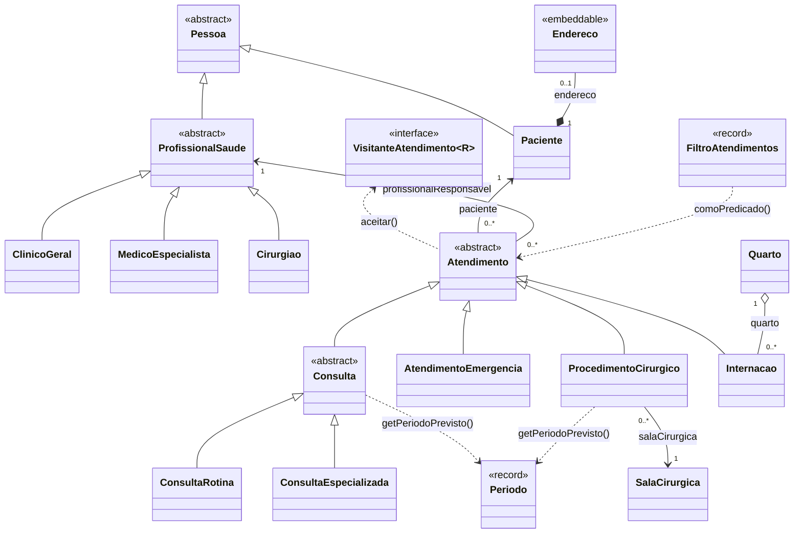

### 1.2 Interfaces e enums

A interface `Descritivel` é implementada pelos enums que têm descrição legível; `SituacaoAtendimento`
estende `Descritivel` e é implementada pelos quatro enums de situação.

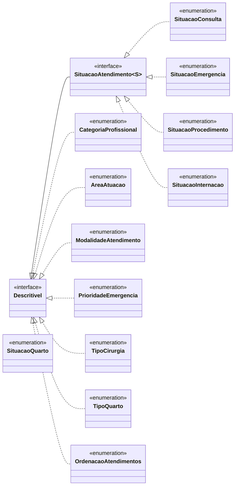

Uso de cada enum pelas classes do modelo. Em todas as associações, a multiplicidade no lado da classe é
`0..*`.

| Enum | Relação | Classe e papel |
|------|---------|----------------|
| `AreaAtuacao` | Associação (1) | `MedicoEspecialista.areaAtuacao`, `Cirurgiao.areaCirurgica`, `ConsultaEspecializada.areaAtuacao` |
| `AreaAtuacao` | Associação (0..1) | `ConsultaRotina.areaEncaminhamento`, nula quando não houve encaminhamento |
| `CategoriaProfissional` | Dependência | `ProfissionalSaude.getCategoria()`; a categoria cria o profissional (`«cria»`) |
| `ModalidadeAtendimento` | Dependência | `Atendimento.getModalidade()` |
| `ModalidadeAtendimento` | Associação (0..1) | `FiltroAtendimentos.modalidade`, nula quando a busca não filtra por modalidade |
| `SituacaoConsulta` | Associação (1) | `Consulta.situacao` |
| `SituacaoEmergencia` | Associação (1) | `AtendimentoEmergencia.situacao` |
| `PrioridadeEmergencia` | Associação (0..1) | `AtendimentoEmergencia.prioridade`, nula até a avaliação |
| `PrioridadeEmergencia` | Dependência | `Atendimento.getPrioridade()`, nula nas modalidades sem prioridade |
| `SituacaoProcedimento` | Associação (1) | `ProcedimentoCirurgico.situacao` |
| `SituacaoInternacao` | Dependência | `Internacao.getSituacao()`, derivada da data de alta e não persistida |
| `OrdenacaoAtendimentos` | Nenhuma no modelo | Escolhida na busca de atendimentos e usada pelos services; depende de `Atendimento` pelo `Comparator` |
| `TipoCirurgia` | Associação (1) | `ProcedimentoCirurgico.tipoCirurgia` |
| `TipoQuarto` | Associação (1) | `Quarto.tipo` |
| `SituacaoQuarto` | Dependência | `Quarto.getSituacao()`, derivada da ocupação e não persistida |

## 2. Pessoas e profissionais

Pacientes e profissionais compartilham os dados de `Pessoa`, que nunca é excluída, apenas inativada. As
categorias de profissional são subclasses de `ProfissionalSaude`, criadas pela fábrica
`CategoriaProfissional`.

### 2.1 Pessoas e fábrica de profissionais

`Pessoa`, o paciente com o seu endereço, a classe base dos profissionais e a fábrica que cria o
profissional de cada categoria.

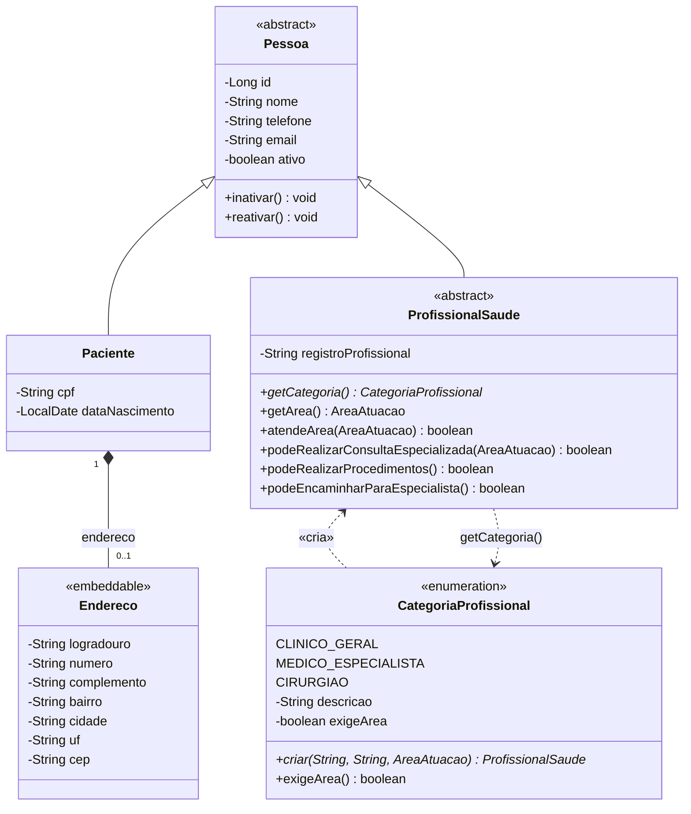

### 2.2 Categorias de profissional

As três categorias e a área em que atuam. Cada subclasse implementa `getCategoria()`; o especialista e o
cirurgião sobrescrevem também os métodos que definem o que podem fazer.

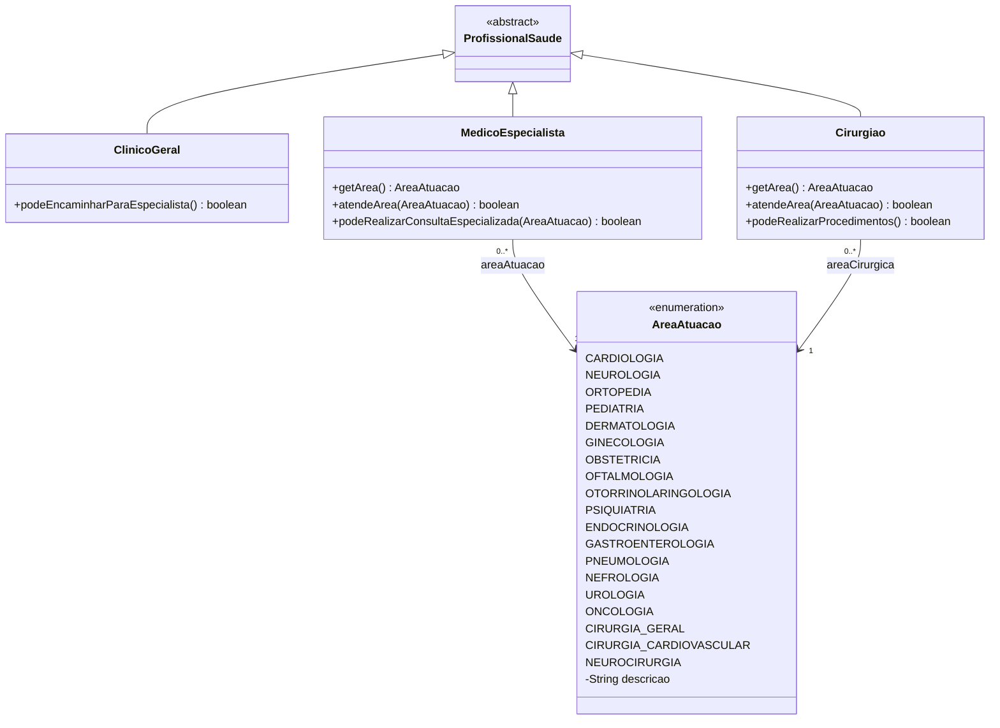

| Categoria | `atendeArea(area)` | `podeRealizarConsultaEspecializada(area)` | `podeRealizarProcedimentos()` | `podeEncaminharParaEspecialista()` |
|-----------|--------------------|-------------------------------------------|-------------------------------|------------------------------------|
| `ClinicoGeral` | falso | falso | falso | verdadeiro |
| `MedicoEspecialista` | verdadeiro na sua área de atuação | verdadeiro na sua área de atuação | falso | falso |
| `Cirurgiao` | verdadeiro na sua área cirúrgica | falso | verdadeiro | falso |

## 3. Atendimentos

`Atendimento` reúne o que é comum a todas as modalidades: paciente, profissional responsável,
observações e a validação de realização (Template Method). Por ter quatro subclasses diretas, a
hierarquia é mostrada em dois diagramas.

Toda modalidade concreta implementa os métodos abstratos de `Atendimento`: `validarCondicoesEspecificas()`,
`getModalidade()`, `getSituacao()`, `getDataHoraReferencia()` e `aceitar(VisitanteAtendimento)`. Na
internação, `getSituacao()` é derivado da data de alta. `getPrioridade()` devolve nulo por padrão e é
sobrescrito só pela emergência, o que permite ordenar qualquer lista de atendimentos pela prioridade.

| Modalidade | Condições específicas (`validarCondicoesEspecificas`) | Data e hora de referência no histórico |
|------------|--------------------------------------------------------|-----------------------------------------|
| `ConsultaRotina` | nenhuma além das comuns (admite encaminhamento por clínico geral) | data e horário da consulta |
| `ConsultaEspecializada` | médico especialista da área da consulta | data e horário da consulta |
| `AtendimentoEmergencia` | prioridade definida | chegada |
| `ProcedimentoCirurgico` | profissional que realiza procedimentos (cirurgião), descrição, tipo de cirurgia, sala cirúrgica ativa, data e hora prevista e duração prevista de 15 a 720 minutos | início real ou, antes dele, a data e hora prevista |
| `Internacao` | alta prevista não anterior à entrada e quarto com vaga | início do dia de entrada |

As condições comuns, verificadas antes das específicas em `validarRealizacao()`, são paciente e
profissional ativos.

### 3.1 Atendimento e consultas

A classe base, as consultas de rotina e especializada com os enums ligados a elas, a modalidade de cada
atendimento e o visitante usado para montar o histórico médico.

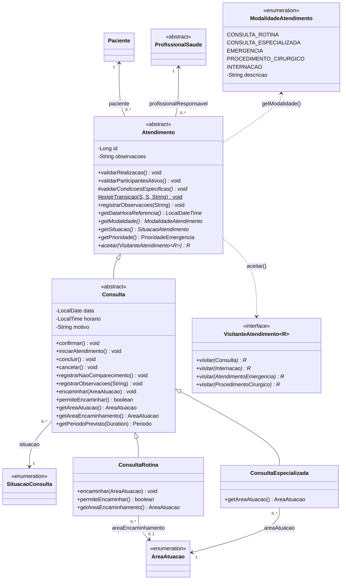

### 3.2 Emergência, procedimento cirúrgico e internação

As outras três modalidades, com as operações que conduzem cada uma pela sua máquina de estados. Os enums,
o quarto e a sala cirúrgica aparecem só pelo nome, para mostrar as associações. Na emergência,
`permiteIniciar()` e `permiteDefinirPrioridade()` são as mesmas regras usadas por `iniciar()` e
`definirPrioridade()`, e a API as informa para a tela mostrar só as ações possíveis.

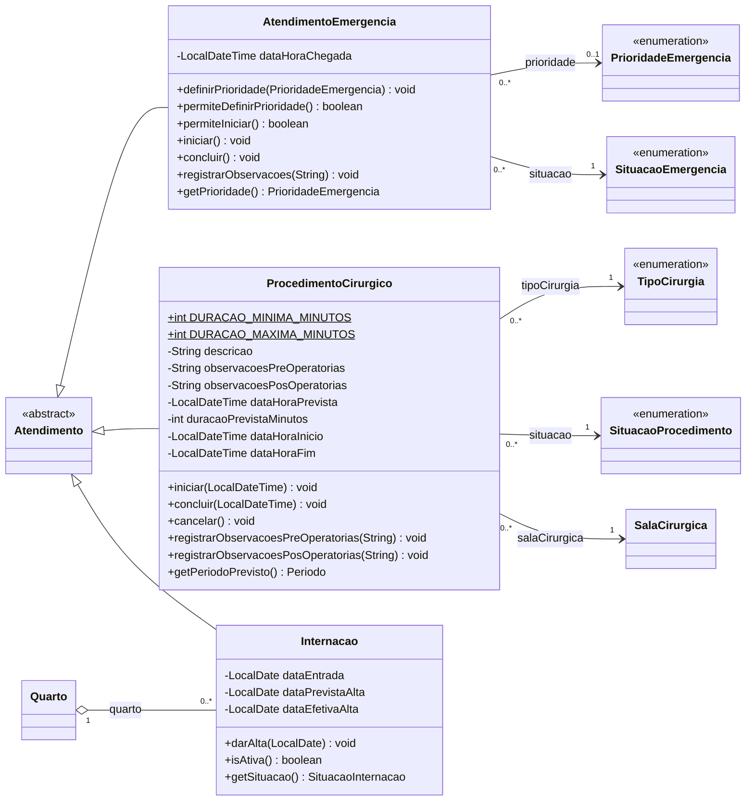

## 4. Situações

As situações de consulta, emergência e procedimento são máquinas de estados, e a prioridade de emergência
e o tipo de cirurgia completam os enums dos atendimentos. A situação da internação (Sprint 3) também
implementa `SituacaoAtendimento`, mas não é guardada: é derivada da data de alta.

### 4.1 Máquinas de estados

Cada enum de situação implementa `SituacaoAtendimento` e declara, em `getProximasPossiveis()`, as
situações para as quais pode passar. `Atendimento.getSituacao()` devolve a situação de qualquer modalidade
como `SituacaoAtendimento`; essa dependência está no diagrama completo.

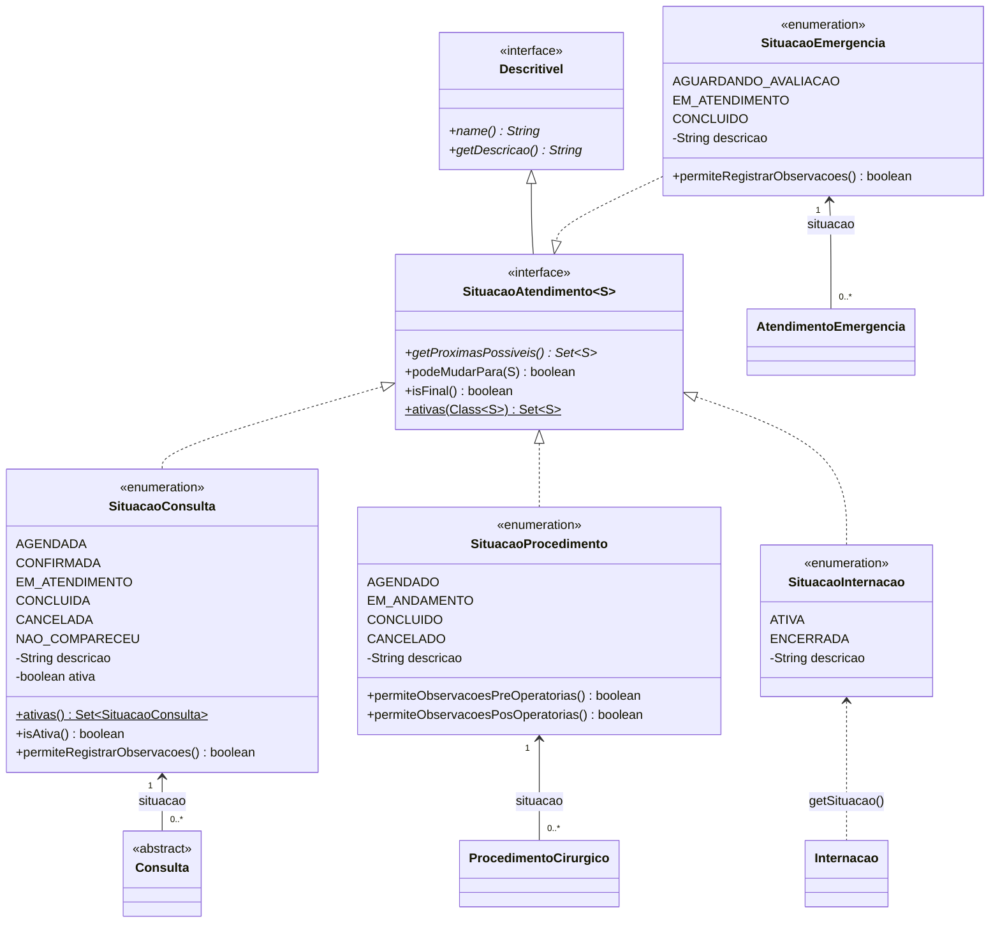

Transições permitidas. Qualquer outra lança `TransicaoSituacaoInvalidaException`, com a mensagem montada
em `Atendimento.exigirTransicao`.

**Consulta** (`SituacaoConsulta`)

| Situação atual | Pode passar para | Operação | Final |
|----------------|------------------|----------|-------|
| `AGENDADA` | `CONFIRMADA`, `CANCELADA`, `NAO_COMPARECEU` | `confirmar()`, `cancelar()`, `registrarNaoComparecimento()` | Não |
| `CONFIRMADA` | `EM_ATENDIMENTO`, `CANCELADA`, `NAO_COMPARECEU` | `iniciarAtendimento()`, `cancelar()`, `registrarNaoComparecimento()` | Não |
| `EM_ATENDIMENTO` | `CONCLUIDA` | `concluir()` | Não |
| `CONCLUIDA` | nenhuma | | Sim |
| `CANCELADA` | nenhuma | | Sim |
| `NAO_COMPARECEU` | nenhuma | | Sim |

`AGENDADA`, `CONFIRMADA` e `EM_ATENDIMENTO` são as situações ativas: ocupam o horário do profissional e do
paciente na verificação de sobreposição. As observações só podem ser registradas em `EM_ATENDIMENTO` e
`CONCLUIDA`. Remarcar uma consulta cancelada significa agendar uma nova.

**Atendimento de emergência** (`SituacaoEmergencia`)

| Situação atual | Pode passar para | Operação | Final |
|----------------|------------------|----------|-------|
| `AGUARDANDO_AVALIACAO` | `EM_ATENDIMENTO` | `iniciar()`, que exige a prioridade definida | Não |
| `EM_ATENDIMENTO` | `CONCLUIDO` | `concluir()` | Não |
| `CONCLUIDO` | nenhuma | | Sim |

**Procedimento cirúrgico** (`SituacaoProcedimento`)

| Situação atual | Pode passar para | Operação | Final |
|----------------|------------------|----------|-------|
| `AGENDADO` | `EM_ANDAMENTO`, `CANCELADO` | `iniciar(LocalDateTime)`, `cancelar()` | Não |
| `EM_ANDAMENTO` | `CONCLUIDO` | `concluir(LocalDateTime)`, com fim não anterior ao início | Não |
| `CONCLUIDO` | nenhuma | | Sim |
| `CANCELADO` | nenhuma | | Sim |

Como `CONCLUIDO` só é alcançável a partir de `EM_ANDAMENTO`, um procedimento não pode ser concluído sem
ter sido iniciado. As observações pós-operatórias só podem ser registradas em `EM_ANDAMENTO` e
`CONCLUIDO`; as pré-operatórias, em qualquer situação.

**Internação** (`SituacaoInternacao`)

| Situação atual | Pode passar para | Operação | Final |
|----------------|------------------|----------|-------|
| `ATIVA` | `ENCERRADA` | `darAlta(LocalDate)`, com alta não anterior à entrada | Não |
| `ENCERRADA` | nenhuma | | Sim |

A situação da internação não é um campo: `getSituacao()` devolve `ATIVA` enquanto não há data efetiva de
alta e `ENCERRADA` depois dela. As observações podem ser registradas nas duas situações.

### 4.2 Prioridade de emergência e tipo de cirurgia

A prioridade ordena a fila de quem aguarda avaliação, da mais grave para a menos grave; o nível numérico
define essa ordem, de `CRITICA` (4) a `BAIXA` (1). A prioridade pode ficar nula até a avaliação.
`Atendimento.getPrioridade()` estende a ordenação por prioridade a qualquer lista de atendimentos: as
modalidades sem prioridade devolvem nulo e ficam no fim.

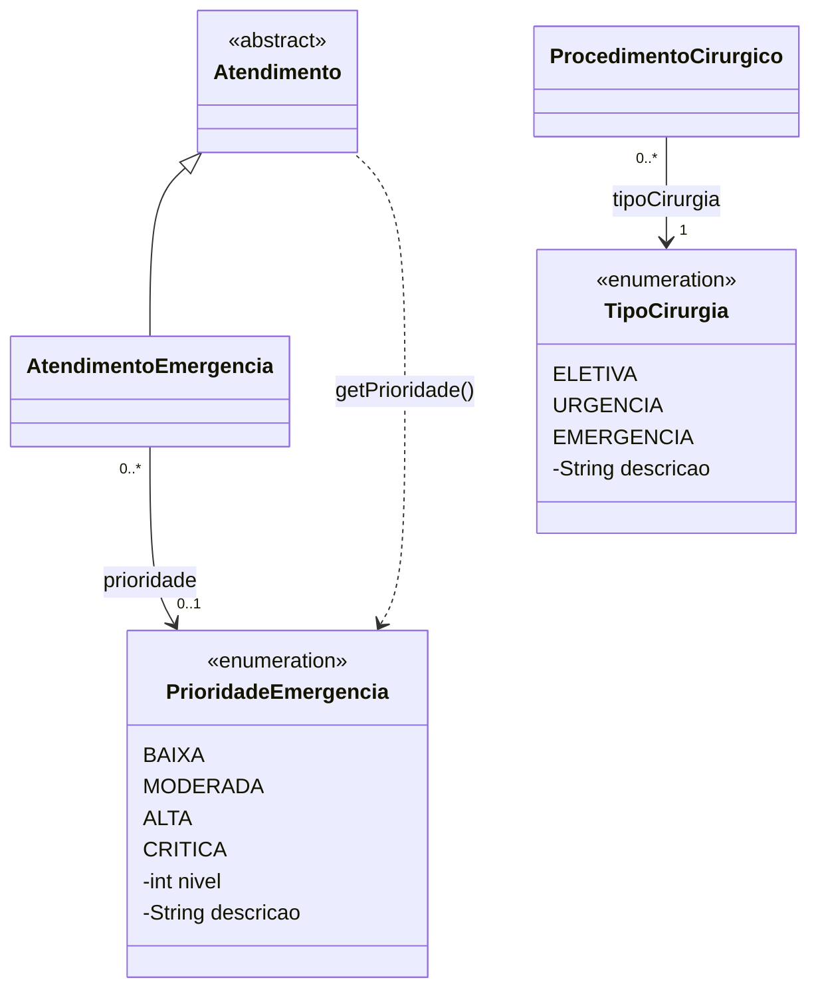

## 5. Quartos, internação e sala cirúrgica

A internação ocupa uma vaga do quarto na admissão e a devolve na alta. O limite de capacidade de cada
tipo fica em `TipoQuarto`, e a situação do quarto é derivada da ocupação. A sala cirúrgica (Sprint 3)
recebe os procedimentos: é obrigatória e precisa estar ativa no agendamento, e o período previsto de cada
procedimento ocupa a sala, o cirurgião e o paciente. Como os pacientes e os profissionais, a sala não é
excluída, só inativada, e não pode ser inativada com procedimento agendado ou em andamento.

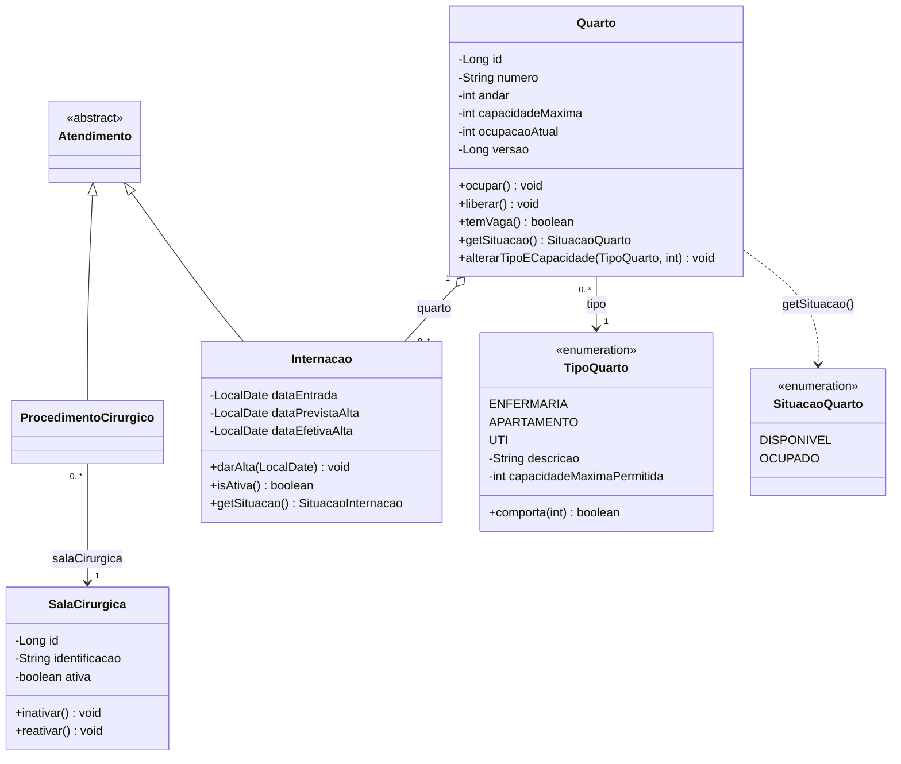

| Tipo de quarto | Capacidade máxima permitida |
|----------------|-----------------------------|
| `ENFERMARIA` | 6 leitos |
| `APARTAMENTO` | 2 leitos |
| `UTI` | 1 leito |

## 6. Período, filtro e ordenação de atendimentos

Tipos da Sprint 3 que tratam atendimentos de qualquer modalidade da mesma forma. `Periodo` é o intervalo
de tempo que uma consulta ou um procedimento ocupa, com a regra de sobreposição num só lugar.
`FiltroAtendimentos` reúne os filtros opcionais da busca e os transforma num único `Predicate`.
`OrdenacaoAtendimentos` associa a cada ordenação oferecida pela API um `Comparator`.

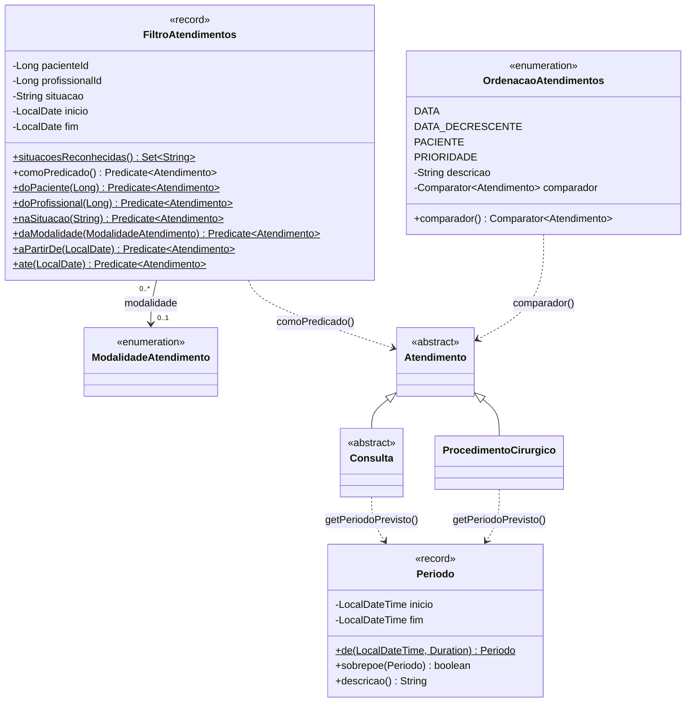

- **`Periodo`**: o construtor recusa período sem início, sem fim ou com fim que não seja posterior ao
  início. Dois períodos se sobrepõem se cada um começa antes do fim do outro, então encostar no início ou
  no fim não é sobreposição. A consulta ocupa a duração configurada (`hospital.consulta.duracao-minutos`,
  30 minutos por padrão) e o procedimento, a sua duração prevista.
- **`FiltroAtendimentos`**: todos os campos são opcionais (a composição do `Predicate` está na
  [seção 8](#8-interfaces-funcionais)). A situação é um texto porque cada modalidade tem o seu enum;
  `situacoesReconhecidas()` lista os códigos de todas, para a API responder 400 a um código desconhecido.
  O período compara a data de referência de cada atendimento, e início posterior ao fim lança
  `DataInvalidaException` (422).
- **`OrdenacaoAtendimentos`**: `DATA` e `DATA_DECRESCENTE` usam a data de referência, com o id como
  desempate; `PACIENTE` usa um `Collator` em português, para que acentos e maiúsculas não alterem a ordem;
  `PRIORIDADE` vai da mais grave à menos grave, com quem não tem prioridade no fim. O enum implementa
  `Descritivel`, e a lista de ordenações chega às telas pelo `GET /dominios`.

## 7. Exceções de domínio

Todas as exceções de domínio estendem `RegraNegocioException`, que estende `RuntimeException`. O
`TratadorDeErros` traduz cada uma numa resposta `ProblemDetail`, com título e mensagem em português. As
três exceções da Sprint 3 são `AtendimentoIndisponivelException`, `ProfissionalIncompativelException` e
`QuartoSemVagasException`, que substituiu a `QuartoSemVagaException` da Sprint 2.

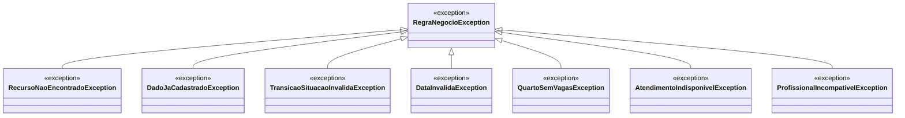

| Exceção | Status | Quando é lançada |
|---------|--------|------------------|
| `RecursoNaoEncontradoException` | 404 | Paciente, profissional, quarto, sala ou atendimento inexistente |
| `DadoJaCadastradoException` | 409 | CPF, registro profissional, número do quarto ou identificação da sala já cadastrados |
| `TransicaoSituacaoInvalidaException` | 409 | Mudança de situação que a máquina de estados não permite (`Atendimento.exigirTransicao`) |
| `AtendimentoIndisponivelException` | 409 | Profissional, paciente ou sala já ocupados no período pedido (`VerificadorDeDisponibilidade`) |
| `QuartoSemVagasException` | 409 | Internação em quarto lotado (`Quarto.ocupar`, verificado também na admissão) |
| `ProfissionalIncompativelException` | 422 | Procedimento com quem não é cirurgião, consulta especializada com quem não é especialista da área, encaminhamento por quem não é clínico geral |
| `DataInvalidaException` | 422 | Consulta no passado, alta anterior à entrada, fim do procedimento anterior ao início, período de busca com início depois do fim |
| `RegraNegocioException` | 422 | Demais regras de negócio, por exemplo participante inativo ou inativação com atendimentos ativos |

## 8. Interfaces funcionais

Na Sprint 3, as partes que variam em disponibilidade, filtros, ordenação e indicadores são passadas como
interfaces funcionais: a regra comum fica num só ponto, e o que muda de um caso para outro chega como
lambda ou referência a método.

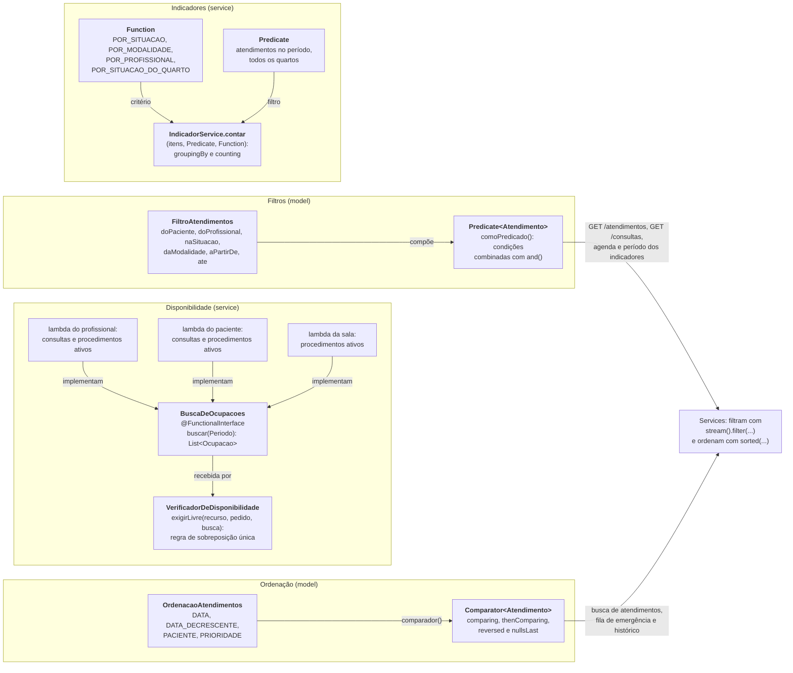

- **`BuscaDeOcupacoes` e `VerificadorDeDisponibilidade`**: cada recurso (profissional, paciente ou sala
  cirúrgica) busca o que o ocupa de um jeito diferente, e cada busca é uma lambda que implementa
  `BuscaDeOcupacoes`. A regra de sobreposição e a mensagem de erro ficam só em `exigirLivre`, que recebe a
  lambda.
- **`Predicate` no `FiltroAtendimentos`**: cada filtro informado vira um `Predicate<Atendimento>`, e
  `comoPredicado()` combina todos com `and`. É o único ponto de filtragem da busca de atendimentos, da
  listagem de consultas, da agenda do profissional e do período dos indicadores. Quartos (com vaga, por
  tipo) e internações (ativas ou encerradas) também filtram com `Predicate`.
- **`Comparator` no `OrdenacaoAtendimentos`**: cada constante guarda o seu `Comparator<Atendimento>`,
  montado com `Comparator.comparing`, `thenComparing`, `reversed` e `nullsLast`. O mesmo enum ordena a
  busca de atendimentos, a fila de emergência (`PRIORIDADE`) e o histórico médico (`DATA`).
- **`Function` e `Predicate` nos indicadores**: `IndicadorService.contar(itens, filtro, criterio)` é o
  único ponto de contagem. O `Predicate` escolhe o que entra (por exemplo, os atendimentos do período) e a
  `Function` define o agrupamento (`Atendimento::getModalidade`, `Atendimento::getProfissionalResponsavel`,
  `Atendimento::getSituacao` e `Quarto::getSituacao`). Cada indicador é uma combinação de filtro e critério,
  sem um laço de contagem próprio.

## 9. Arquitetura em camadas e padrões de projeto

As dependências seguem de cima para baixo: controller, service, repository e model. Dentro do modelo,
quatro padrões de projeto organizam o comportamento que varia entre as classes.

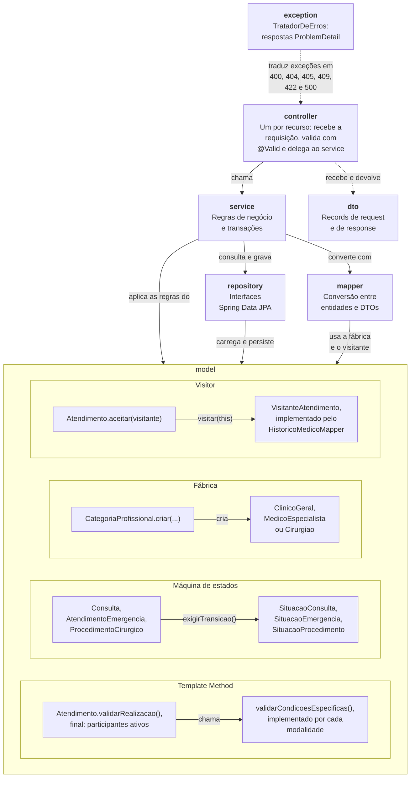

## 10. Decisões de modelagem

- **Endereço como objeto de valor.** Na conversa em sala sobre o diagrama da Sprint 1, o professor
  questionou se fazia sentido manter uma classe só para o endereço. Analisamos depois e decidimos
  mantê-la, por três motivos: os sete campos do endereço (logradouro, número, complemento, bairro,
  cidade, UF e CEP) sempre andam juntos, e agrupá-los deixa a classe `Paciente` mais coesa; o endereço é
  um objeto de valor, sem identidade própria e que não existe sem o paciente, o que justifica a
  composição; e ele não gera uma tabela separada no banco, porque fica embutido na própria tabela do
  paciente, então organiza o código sem nenhum custo na persistência.
- **Internação agregada ao quarto.** O quarto reúne as internações que recebe, mas cada internação tem
  identidade e ciclo de vida próprios e continua no histórico depois da alta; por isso a relação é uma
  agregação, e não uma composição.
- **Categorias de profissional por herança (SINGLE_TABLE).** `ClinicoGeral`, `MedicoEspecialista` e
  `Cirurgiao` diferem por uma coluna de área; com tabela única, listar profissionais e carregar o
  responsável de um atendimento não exige joins. O que muda entre as categorias fica em métodos
  sobrescritos (`atendeArea`, `podeRealizarConsultaEspecializada`, `podeRealizarProcedimentos` e
  `podeEncaminharParaEspecialista`), sem testes de tipo. O cirurgião aparece na listagem da sua área, mas não realiza consulta especializada.
- **Modalidades de atendimento por herança (JOINED).** As modalidades têm campos muito diferentes; com
  uma tabela por modalidade, cada uma mantém as suas colunas obrigatórias como `NOT NULL`. Os campos
  comuns (paciente, profissional e observações) ficam na tabela `atendimento`.
- **Template Method na validação.** `validarRealizacao()` é `final` em `Atendimento`: verifica paciente e
  profissional ativos e chama `validarCondicoesEspecificas()`, que cada modalidade implementa com as suas
  regras.
- **Situações como máquinas de estados nos enums.** Cada enum de situação declara as transições
  permitidas em `getProximasPossiveis()`; a verificação e a mensagem de erro ficam num único ponto,
  `Atendimento.exigirTransicao`.
- **Fábrica em `CategoriaProfissional`.** Cada constante sabe criar o profissional da sua categoria. No
  sentido inverso, cada subclasse informa a sua categoria e a sua área por `getCategoria()` e
  `getArea()`.
- **Visitor no histórico médico.** `Atendimento.aceitar(visitante)` chama a sobrecarga de `visitar`
  correspondente à modalidade; o mapper do histórico implementa o visitante e obtém os dados próprios de
  cada modalidade sem `instanceof`, o que funciona também com proxies do Hibernate. A ordem cronológica
  usa o método polimórfico `getDataHoraReferencia()`.
- **Limite de capacidade no enum `TipoQuarto`.** O limite de cada tipo é uma suposição do grupo e pode
  mudar; por isso fica só no código, e o banco restringe apenas os valores do tipo. Tipo e capacidade
  mudam juntos, em `alterarTipoECapacidade`, porque cada um limita o outro.
- **Procedimentos realizados sem coleção mapeada.** `Cirurgiao` não tem uma lista de procedimentos: eles
  são obtidos por consulta no repository (procedimentos concluídos do profissional). Uma coleção mapeada
  cresceria sem limite e incluiria também os procedimentos cancelados.
- **Histórico preservado.** Pacientes e profissionais são inativados, nunca excluídos, e não podem ser
  inativados com atendimentos em andamento. Quarto que já recebeu internação não é removido.

Decisões da Sprint 3:

- **Exceções específicas para os conflitos de agenda e de vaga.** Horário ocupado
  (`AtendimentoIndisponivelException`) e quarto lotado (`QuartoSemVagasException`) são conflitos com o
  estado atual de um recurso e respondem 409. Profissional da categoria errada
  (`ProfissionalIncompativelException`) é uma regra que a requisição não atende e responde 422.
- **Disponibilidade só no agendamento, entre consultas e procedimentos.** Profissional, paciente e sala não
  podem ter dois atendimentos com horário marcado no mesmo período. Emergência e internação ficam fora,
  porque não têm horário marcado, e iniciar um atendimento não verifica a agenda de novo. Dois agendamentos
  simultâneos para o mesmo horário não são bloqueados: é uma limitação conhecida.
- **Período do procedimento pela duração prevista.** O procedimento passou a ter duração prevista (15 a 720
  minutos) e sala obrigatória; o período que ele ocupa é sempre o previsto, mesmo depois de iniciado. A
  migration V8 criou a sala padrão e a duração de 60 minutos para os procedimentos que já existiam.
- **Sala cirúrgica sem remoção física.** Como pacientes e profissionais, a sala é inativada, e a inativação
  é recusada se houver procedimento agendado ou em andamento nela.
- **Situação polimórfica.** `getSituacao()` em `Atendimento` permite filtrar, ordenar e contar atendimentos
  de qualquer modalidade sem testes de tipo. A situação da internação é derivada da data de alta, e não um
  campo novo no banco.
- **Filtragem e ordenação em memória.** Um único `Predicate` e um único `Comparator` atendem a todas as
  combinações de filtros e ordenações, sem uma consulta JPQL para cada combinação (usos na
  [seção 8](#8-interfaces-funcionais)).
- **Permissões informadas pela API.** As respostas de consulta, emergência e procedimento trazem as
  próximas situações e o que pode ser feito agora (`permiteIniciar`, `permiteRegistrarObservacoes` e
  outros), calculados pelos mesmos métodos que aplicam as regras. As telas mostram só as ações permitidas
  e não repetem regras.
