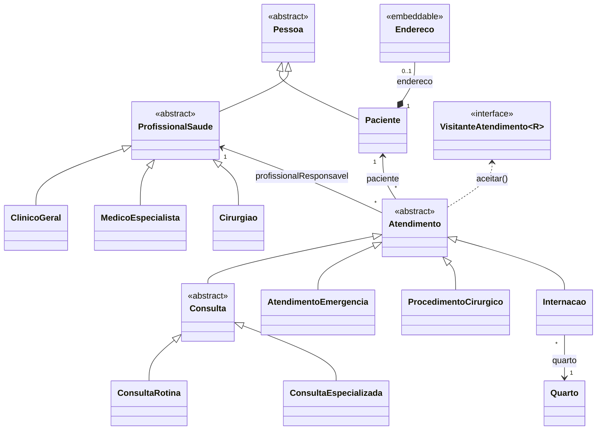
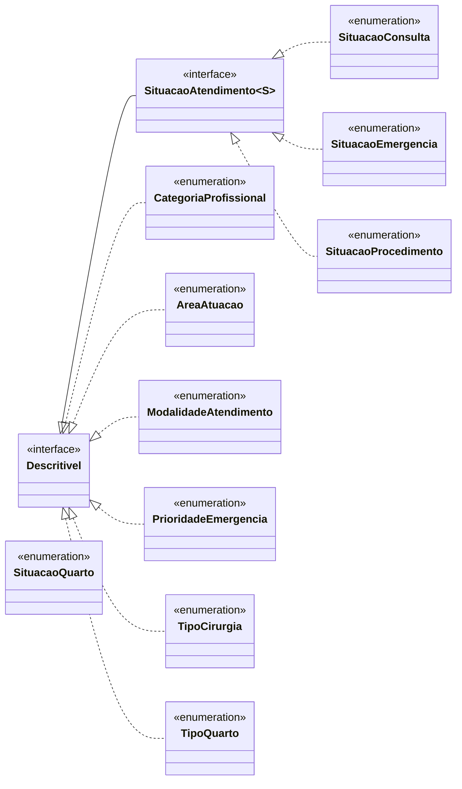
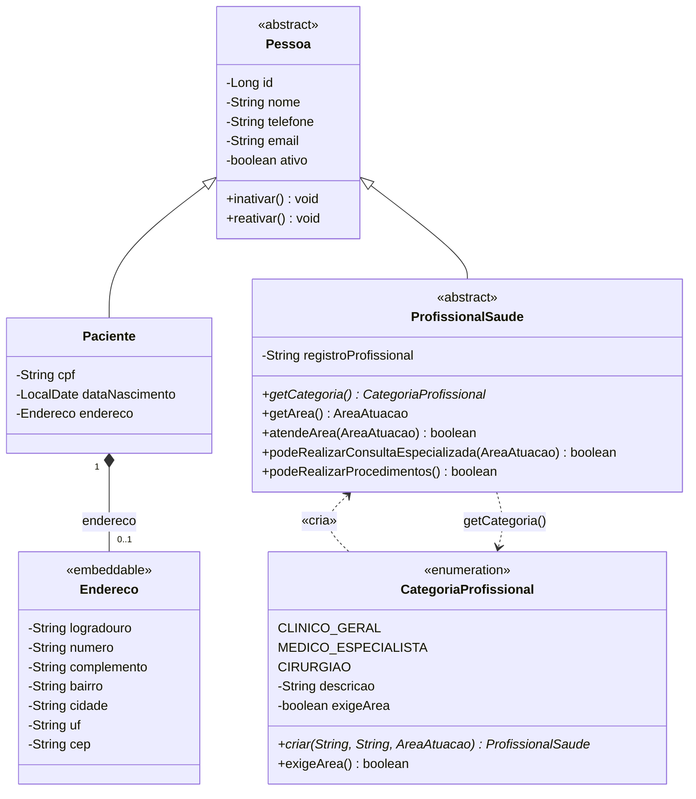
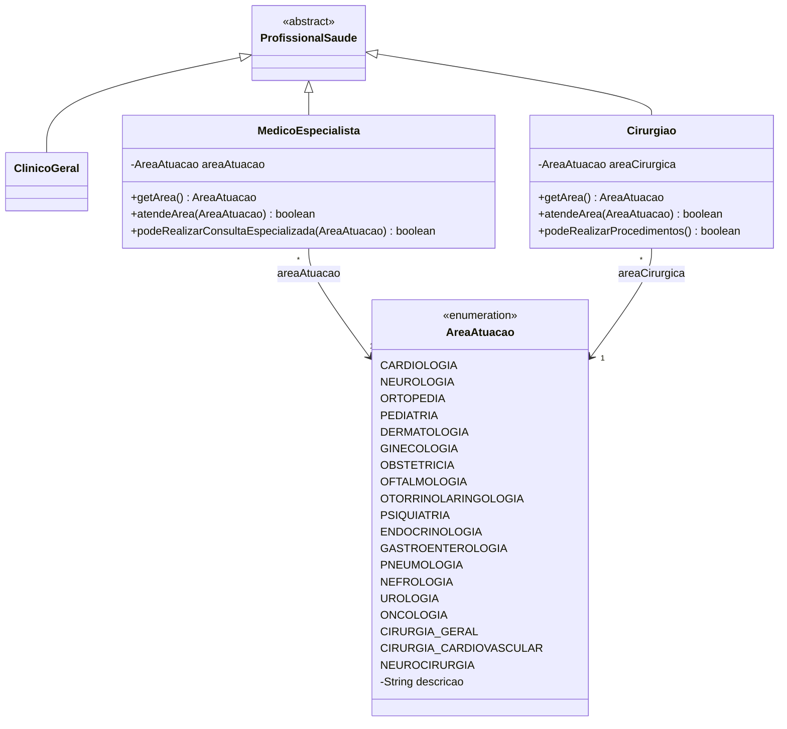
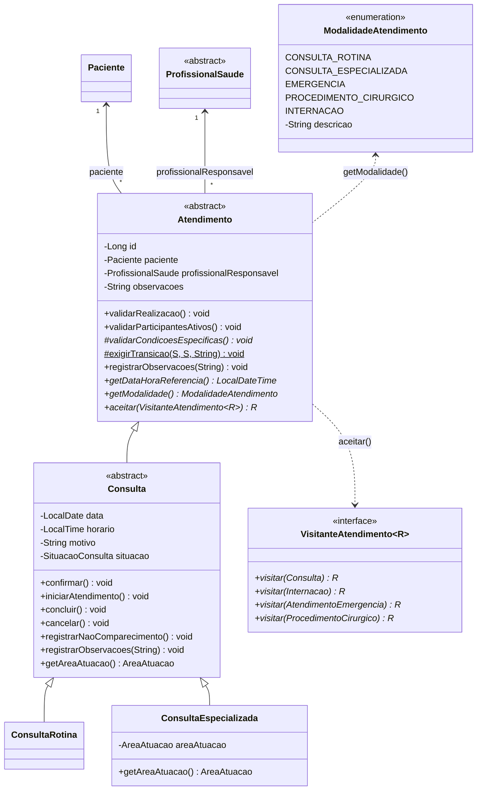
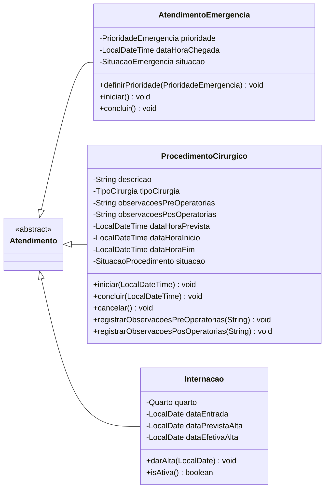
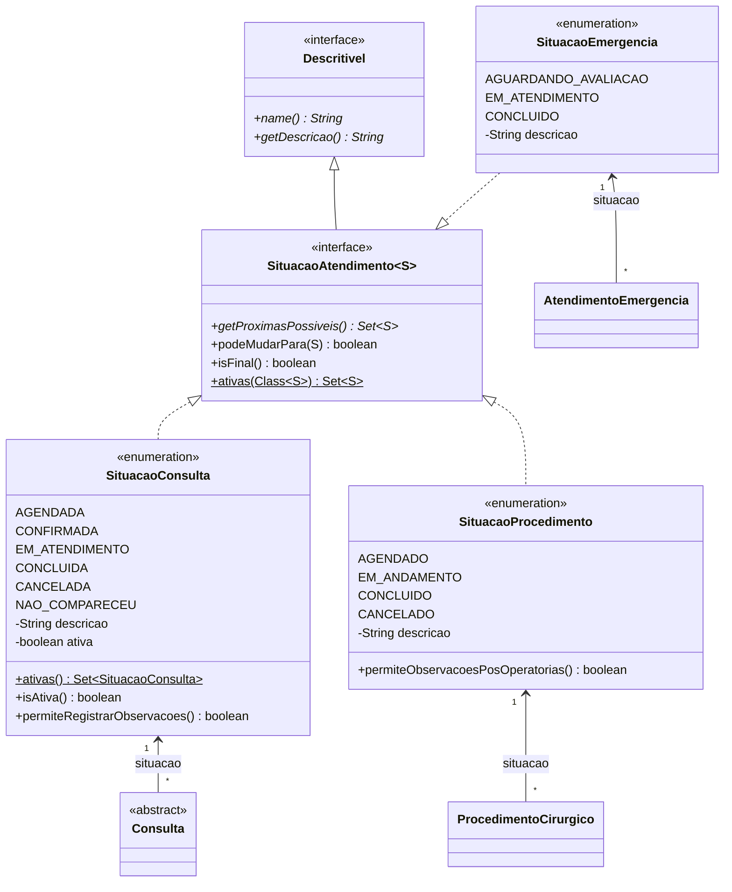
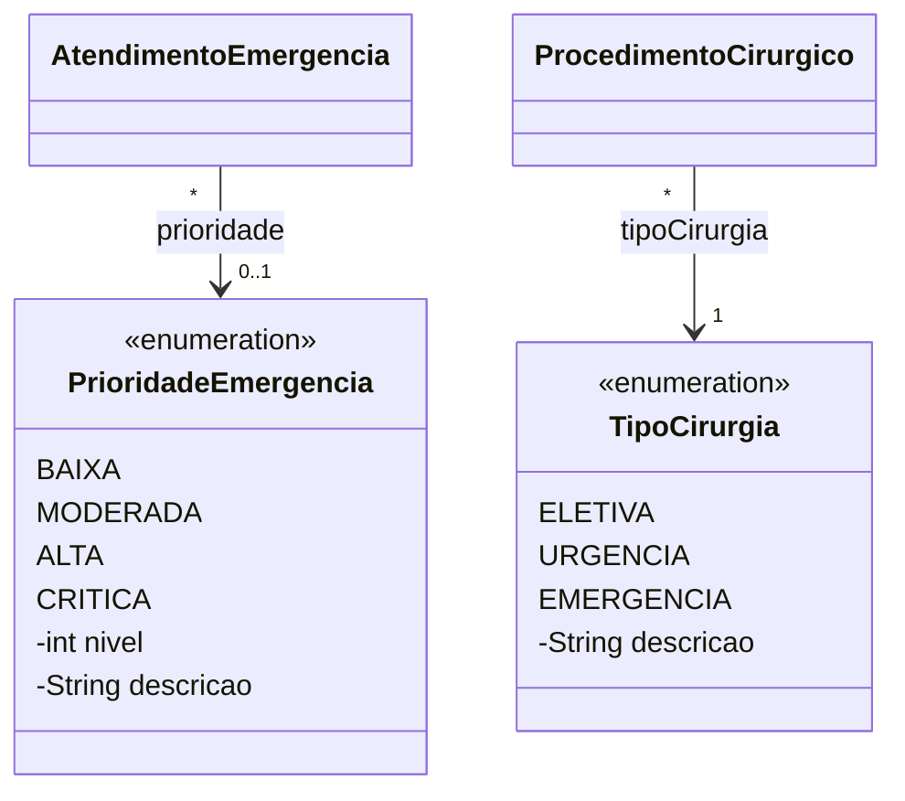
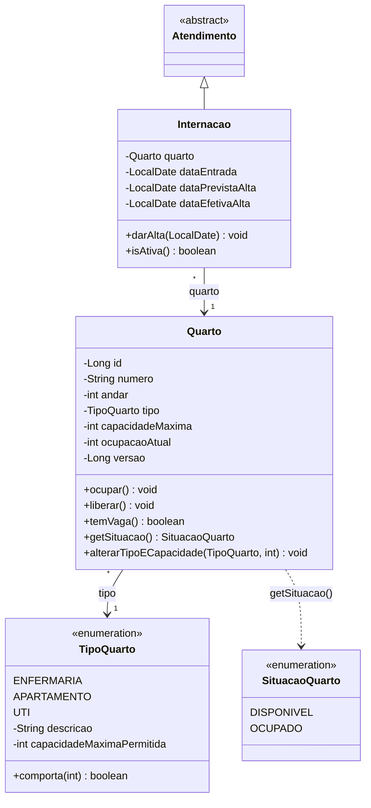
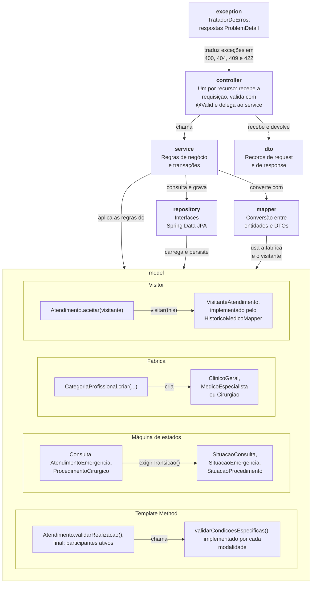

# Diagrama de classes - Sprint 2

Modelo de domínio do pacote `br.pucminas.hospital.model` ao fim da Sprint 2. O modelo tem 28 tipos; para
que cada desenho fique legível na largura da página, ele está dividido em uma visão geral, só com os nomes
dos tipos, e em diagramas de detalhe com no máximo dez tipos cada. O diagrama da Sprint 1 continua
disponível em
[diagrama-de-classes.png](diagrama-de-classes.png).

## Sumário

1. [Visão geral](#1-visão-geral)
   - [1.1 Classes e associações](#11-classes-e-associações)
   - [1.2 Interfaces e enums](#12-interfaces-e-enums)
2. [Pessoas e profissionais](#2-pessoas-e-profissionais)
   - [2.1 Pessoas e fábrica de profissionais](#21-pessoas-e-fábrica-de-profissionais)
   - [2.2 Categorias de profissional](#22-categorias-de-profissional)
3. [Atendimentos](#3-atendimentos)
   - [3.1 Atendimento e consultas](#31-atendimento-e-consultas)
   - [3.2 Emergência, procedimento cirúrgico e internação](#32-emergência-procedimento-cirúrgico-e-internação)
4. [Situações](#4-situações)
   - [4.1 Máquinas de estados](#41-máquinas-de-estados)
   - [4.2 Prioridade de emergência e tipo de cirurgia](#42-prioridade-de-emergência-e-tipo-de-cirurgia)
5. [Quartos e internação](#5-quartos-e-internação)
6. [Arquitetura em camadas e padrões de projeto](#6-arquitetura-em-camadas-e-padrões-de-projeto)
7. [Decisões de modelagem](#7-decisões-de-modelagem)

## Notação

| Elemento | Significado |
|----------|-------------|
| `-` `#` `+` antes do membro | Visibilidade privada, protegida e pública |
| Método em itálico | Método abstrato |
| Método sublinhado | Método estático |
| «abstract» | Classe abstrata |
| «interface» | Interface |
| «enumeration» | Enum; as constantes aparecem antes dos atributos |
| «embeddable» | Objeto de valor embutido na entidade (JPA `@Embeddable`) |
| Linha cheia com triângulo vazado | Herança |
| Linha tracejada com triângulo vazado | Realização de interface |
| Linha cheia com losango cheio | Composição (o losango fica no lado do todo) |
| Linha cheia com seta | Associação, com multiplicidade nas pontas e nome do papel |
| Linha tracejada com seta | Dependência, com a operação ou o estereótipo que a origina |

Critérios usados em todos os diagramas:

- Nos parâmetros dos métodos consta apenas o tipo.
- Getters e setters não aparecem, exceto os que têm comportamento de domínio: os que as subclasses
  sobrescrevem (`getArea`, `getAreaAtuacao`) e os que expressam uma regra (`Quarto.getSituacao`, derivada
  da ocupação; `Internacao.isAtiva`, derivada da data de alta; `SituacaoConsulta.isAtiva`, que indica se a
  consulta ocupa horário).
- A implementação de um método abstrato não é repetida na subclasse: o método aparece uma vez, marcado
  com `*`, na classe ou na interface que o declara, e toda classe concreta da hierarquia o implementa.
  Sobrescritas de métodos concretos aparecem na subclasse, porque são elas que mostram o polimorfismo.
- Nos diagramas de detalhe, as classes de outras seções aparecem só pelo nome, para mostrar a relação.
- A interface `Descritivel`, implementada por todos os enums que têm descrição, aparece com as suas
  realizações nos diagramas 1.2 e 4.1; nos demais, a realização é omitida para não repetir a mesma seta.

## 1. Visão geral

Todos os tipos do modelo e as relações entre eles, apenas com os nomes e os estereótipos. A visão geral
está dividida em duas partes: as classes com as suas heranças e associações, e as interfaces com os enums
que as implementam. As associações entre classes e enums estão na tabela ao fim da seção e desenhadas nos
diagramas de detalhe.

### 1.1 Classes e associações

As duas hierarquias do modelo, `Pessoa` e `Atendimento`, e as associações que ligam um atendimento ao
paciente, ao profissional responsável e, na internação, ao quarto.

### 1.2 Interfaces e enums

A interface `Descritivel` é implementada pelos enums que têm descrição legível; `SituacaoAtendimento`
estende `Descritivel` e é implementada pelos três enums de situação.

Uso de cada enum pelas classes do modelo. Em todas as associações, a multiplicidade no lado da classe é
`*`.

| Enum | Relação | Classe e papel |
|------|---------|----------------|
| `AreaAtuacao` | Associação (1) | `MedicoEspecialista.areaAtuacao`, `Cirurgiao.areaCirurgica`, `ConsultaEspecializada.areaAtuacao` |
| `CategoriaProfissional` | Dependência | `ProfissionalSaude.getCategoria()`; a categoria cria o profissional (`«cria»`) |
| `ModalidadeAtendimento` | Dependência | `Atendimento.getModalidade()` |
| `SituacaoConsulta` | Associação (1) | `Consulta.situacao` |
| `SituacaoEmergencia` | Associação (1) | `AtendimentoEmergencia.situacao` |
| `PrioridadeEmergencia` | Associação (0..1) | `AtendimentoEmergencia.prioridade`, nula até a avaliação |
| `SituacaoProcedimento` | Associação (1) | `ProcedimentoCirurgico.situacao` |
| `TipoCirurgia` | Associação (1) | `ProcedimentoCirurgico.tipoCirurgia` |
| `TipoQuarto` | Associação (1) | `Quarto.tipo` |
| `SituacaoQuarto` | Dependência | `Quarto.getSituacao()`, derivada da ocupação e não persistida |

## 2. Pessoas e profissionais

Pacientes e profissionais compartilham os dados de `Pessoa`, que nunca é excluída, apenas inativada. As
categorias de profissional são subclasses de `ProfissionalSaude`, criadas pela fábrica
`CategoriaProfissional`.

### 2.1 Pessoas e fábrica de profissionais

`Pessoa`, o paciente com o seu endereço, a classe base dos profissionais e a fábrica que cria o
profissional de cada categoria.

### 2.2 Categorias de profissional

As três categorias e a área em que atuam. Cada subclasse implementa `getCategoria()`; o especialista e o
cirurgião sobrescrevem também os métodos que definem o que podem fazer.

| Categoria | `atendeArea(area)` | `podeRealizarConsultaEspecializada(area)` | `podeRealizarProcedimentos()` |
|-----------|--------------------|-------------------------------------------|-------------------------------|
| `ClinicoGeral` | falso | falso | falso |
| `MedicoEspecialista` | verdadeiro na sua área de atuação | verdadeiro na sua área de atuação | falso |
| `Cirurgiao` | verdadeiro na sua área cirúrgica | falso | verdadeiro |

## 3. Atendimentos

`Atendimento` reúne o que é comum a todas as modalidades: paciente, profissional responsável,
observações e a validação de realização (Template Method). Por ter quatro subclasses diretas, a
hierarquia é mostrada em dois diagramas.

Toda modalidade concreta implementa os métodos abstratos de `Atendimento`: `validarCondicoesEspecificas()`,
`getModalidade()`, `getDataHoraReferencia()` e `aceitar(VisitanteAtendimento)`.

| Modalidade | Condições específicas (`validarCondicoesEspecificas`) | Data e hora de referência no histórico |
|------------|--------------------------------------------------------|-----------------------------------------|
| `ConsultaRotina` | nenhuma além das comuns | data e horário da consulta |
| `ConsultaEspecializada` | médico especialista da área da consulta | data e horário da consulta |
| `AtendimentoEmergencia` | prioridade definida | chegada |
| `ProcedimentoCirurgico` | profissional que realiza procedimentos (cirurgião), descrição, tipo de cirurgia e data e hora prevista | início real ou, antes dele, a data e hora prevista |
| `Internacao` | alta prevista não anterior à entrada e quarto com vaga | início do dia de entrada |

As condições comuns, verificadas antes das específicas em `validarRealizacao()`, são paciente e
profissional ativos.

### 3.1 Atendimento e consultas

A classe base, as consultas de rotina e especializada, a modalidade de cada atendimento e o visitante
usado para montar o histórico médico.

### 3.2 Emergência, procedimento cirúrgico e internação

As outras três modalidades, com as operações que conduzem cada uma pela sua máquina de estados.

## 4. Situações

As situações de consulta, emergência e procedimento são máquinas de estados, e a prioridade de emergência
e o tipo de cirurgia completam os enums dos atendimentos.

### 4.1 Máquinas de estados

Cada enum de situação implementa `SituacaoAtendimento` e declara, em `getProximasPossiveis()`, as
situações para as quais pode passar.

Transições permitidas. Qualquer outra lança `TransicaoSituacaoInvalidaException`, com a mensagem montada
em `Atendimento.exigirTransicao`.

**Consulta** (`SituacaoConsulta`)

| Situação atual | Pode passar para | Operação | Final |
|----------------|------------------|----------|-------|
| `AGENDADA` | `CONFIRMADA`, `CANCELADA`, `NAO_COMPARECEU` | `confirmar()`, `cancelar()`, `registrarNaoComparecimento()` | Não |
| `CONFIRMADA` | `EM_ATENDIMENTO`, `CANCELADA`, `NAO_COMPARECEU` | `iniciarAtendimento()`, `cancelar()`, `registrarNaoComparecimento()` | Não |
| `EM_ATENDIMENTO` | `CONCLUIDA` | `concluir()` | Não |
| `CONCLUIDA` | nenhuma | | Sim |
| `CANCELADA` | nenhuma | | Sim |
| `NAO_COMPARECEU` | nenhuma | | Sim |

`AGENDADA`, `CONFIRMADA` e `EM_ATENDIMENTO` são as situações ativas: ocupam o horário do profissional e do
paciente na verificação de sobreposição. As observações só podem ser registradas em `EM_ATENDIMENTO` e
`CONCLUIDA`. Remarcar uma consulta cancelada significa agendar uma nova.

**Atendimento de emergência** (`SituacaoEmergencia`)

| Situação atual | Pode passar para | Operação | Final |
|----------------|------------------|----------|-------|
| `AGUARDANDO_AVALIACAO` | `EM_ATENDIMENTO` | `iniciar()`, que exige a prioridade definida | Não |
| `EM_ATENDIMENTO` | `CONCLUIDO` | `concluir()` | Não |
| `CONCLUIDO` | nenhuma | | Sim |

**Procedimento cirúrgico** (`SituacaoProcedimento`)

| Situação atual | Pode passar para | Operação | Final |
|----------------|------------------|----------|-------|
| `AGENDADO` | `EM_ANDAMENTO`, `CANCELADO` | `iniciar(LocalDateTime)`, `cancelar()` | Não |
| `EM_ANDAMENTO` | `CONCLUIDO` | `concluir(LocalDateTime)`, com fim não anterior ao início | Não |
| `CONCLUIDO` | nenhuma | | Sim |
| `CANCELADO` | nenhuma | | Sim |

Como `CONCLUIDO` só é alcançável a partir de `EM_ANDAMENTO`, um procedimento não pode ser concluído sem
ter sido iniciado. As observações pós-operatórias só podem ser registradas em `EM_ANDAMENTO` e
`CONCLUIDO`.

### 4.2 Prioridade de emergência e tipo de cirurgia

A prioridade ordena a fila de quem aguarda avaliação, da mais grave para a menos grave; o nível numérico
define essa ordem, de `CRITICA` (4) a `BAIXA` (1). A prioridade pode ficar nula até a avaliação.

## 5. Quartos e internação

A internação ocupa uma vaga do quarto na admissão e a devolve na alta. O limite de capacidade de cada
tipo fica em `TipoQuarto`, e a situação do quarto é derivada da ocupação.

| Tipo de quarto | Capacidade máxima permitida |
|----------------|-----------------------------|
| `ENFERMARIA` | 6 leitos |
| `APARTAMENTO` | 2 leitos |
| `UTI` | 1 leito |

## 6. Arquitetura em camadas e padrões de projeto

As dependências seguem de cima para baixo: controller, service, repository e model. Dentro do modelo,
quatro padrões de projeto organizam o comportamento que varia entre as classes.

## 7. Decisões de modelagem

- **Categorias de profissional por herança (SINGLE_TABLE).** `ClinicoGeral`, `MedicoEspecialista` e
  `Cirurgiao` diferem por uma coluna de área; com tabela única, listar profissionais e carregar o
  responsável de um atendimento não exige joins. O que muda entre as categorias fica em métodos
  sobrescritos (`atendeArea`, `podeRealizarConsultaEspecializada` e `podeRealizarProcedimentos`), sem
  testes de tipo. O cirurgião aparece na listagem da sua área, mas não realiza consulta especializada.
- **Modalidades de atendimento por herança (JOINED).** As modalidades têm campos muito diferentes; com
  uma tabela por modalidade, cada uma mantém as suas colunas obrigatórias como `NOT NULL`. Os campos
  comuns (paciente, profissional e observações) ficam na tabela `atendimento`.
- **Template Method na validação.** `validarRealizacao()` é `final` em `Atendimento`: verifica paciente e
  profissional ativos e chama `validarCondicoesEspecificas()`, que cada modalidade implementa com as suas
  regras.
- **Situações como máquinas de estados nos enums.** Cada enum de situação declara as transições
  permitidas em `getProximasPossiveis()`; a verificação e a mensagem de erro ficam num único ponto,
  `Atendimento.exigirTransicao`.
- **Fábrica em `CategoriaProfissional`.** Cada constante sabe criar o profissional da sua categoria. No
  sentido inverso, cada subclasse informa a sua categoria e a sua área por `getCategoria()` e
  `getArea()`.
- **Visitor no histórico médico.** `Atendimento.aceitar(visitante)` chama a sobrecarga de `visitar`
  correspondente à modalidade; o mapper do histórico implementa o visitante e obtém os dados próprios de
  cada modalidade sem `instanceof`, o que funciona também com proxies do Hibernate. A ordem cronológica
  usa o método polimórfico `getDataHoraReferencia()`.
- **Limite de capacidade no enum `TipoQuarto`.** O limite de cada tipo é uma suposição do grupo e pode
  mudar; por isso fica só no código, e o banco restringe apenas os valores do tipo. Tipo e capacidade
  mudam juntos, em `alterarTipoECapacidade`, porque cada um limita o outro.
- **Procedimentos realizados sem coleção mapeada.** `Cirurgiao` não tem uma lista de procedimentos: eles
  são obtidos por consulta no repository (procedimentos concluídos do profissional). Uma coleção mapeada
  cresceria sem limite e incluiria também os procedimentos cancelados.
- **Histórico preservado.** Pacientes e profissionais são inativados, nunca excluídos, e não podem ser
  inativados com atendimentos em andamento. Quarto que já recebeu internação não é removido.
