# Diagrama de classes - Sprint 2

Modelo de domínio do pacote `br.pucminas.hospital.model`, como está no código ao fim da Sprint 2. O
diagrama da Sprint 1 continua em [diagrama-de-classes.png](diagrama-de-classes.png).

Convenções: `-` privado, `#` protegido, `+` público; `*` método abstrato, `$` método estático. Getters e
setters ficam de fora; aparecem apenas os que têm comportamento de domínio (sobrescritos por subclasse ou
derivados, como `Quarto.getSituacao()`). Os campos que são associações aparecem também nas setas, com o
nome do papel.

## Modelo de domínio

```mermaid
classDiagram
    direction TB

    %% Pessoas ---------------------------------------------------------------
    class Pessoa {
        <<abstract>>
        -Long id
        -String nome
        -String telefone
        -String email
        -boolean ativo
        +inativar() void
        +reativar() void
    }

    class Paciente {
        -String cpf
        -LocalDate dataNascimento
        -Endereco endereco
    }

    class Endereco {
        <<embeddable>>
        -String logradouro
        -String numero
        -String complemento
        -String bairro
        -String cidade
        -String uf
        -String cep
    }

    class ProfissionalSaude {
        <<abstract>>
        -String registroProfissional
        +getCategoria()* CategoriaProfissional
        +getArea() AreaAtuacao
        +atendeArea(AreaAtuacao area) boolean
        +podeRealizarConsultaEspecializada(AreaAtuacao area) boolean
        +podeRealizarProcedimentos() boolean
    }

    class ClinicoGeral {
        +getCategoria() CategoriaProfissional
    }

    class MedicoEspecialista {
        -AreaAtuacao areaAtuacao
        +getCategoria() CategoriaProfissional
        +getArea() AreaAtuacao
        +atendeArea(AreaAtuacao area) boolean
        +podeRealizarConsultaEspecializada(AreaAtuacao area) boolean
    }

    class Cirurgiao {
        -AreaAtuacao areaCirurgica
        +getCategoria() CategoriaProfissional
        +getArea() AreaAtuacao
        +atendeArea(AreaAtuacao area) boolean
        +podeRealizarProcedimentos() boolean
    }

    %% Atendimentos ----------------------------------------------------------
    class Atendimento {
        <<abstract>>
        -Long id
        -Paciente paciente
        -ProfissionalSaude profissionalResponsavel
        -String observacoes
        +validarRealizacao() void
        +validarParticipantesAtivos() void
        #validarCondicoesEspecificas()* void
        #exigirTransicao(S atual, S nova, String acao)$ void
        +registrarObservacoes(String texto) void
        +getDataHoraReferencia()* LocalDateTime
        +getModalidade()* ModalidadeAtendimento
        +aceitar(VisitanteAtendimento~R~ visitante)* R
    }

    class Consulta {
        <<abstract>>
        -LocalDate data
        -LocalTime horario
        -String motivo
        -SituacaoConsulta situacao
        +confirmar() void
        +iniciarAtendimento() void
        +concluir() void
        +cancelar() void
        +registrarNaoComparecimento() void
        +registrarObservacoes(String texto) void
        +getAreaAtuacao() AreaAtuacao
        +getDataHoraReferencia() LocalDateTime
        +aceitar(VisitanteAtendimento~R~ visitante) R
    }

    class ConsultaRotina {
        #validarCondicoesEspecificas() void
        +getModalidade() ModalidadeAtendimento
    }

    class ConsultaEspecializada {
        -AreaAtuacao areaAtuacao
        #validarCondicoesEspecificas() void
        +getModalidade() ModalidadeAtendimento
        +getAreaAtuacao() AreaAtuacao
    }

    class Internacao {
        -Quarto quarto
        -LocalDate dataEntrada
        -LocalDate dataPrevistaAlta
        -LocalDate dataEfetivaAlta
        +darAlta(LocalDate dataEfetivaAlta) void
        +isAtiva() boolean
        #validarCondicoesEspecificas() void
        +getModalidade() ModalidadeAtendimento
        +getDataHoraReferencia() LocalDateTime
        +aceitar(VisitanteAtendimento~R~ visitante) R
    }

    class AtendimentoEmergencia {
        -PrioridadeEmergencia prioridade
        -LocalDateTime dataHoraChegada
        -SituacaoEmergencia situacao
        +definirPrioridade(PrioridadeEmergencia prioridade) void
        +iniciar() void
        +concluir() void
        #validarCondicoesEspecificas() void
        +getModalidade() ModalidadeAtendimento
        +getDataHoraReferencia() LocalDateTime
        +aceitar(VisitanteAtendimento~R~ visitante) R
    }

    class ProcedimentoCirurgico {
        -String descricao
        -TipoCirurgia tipoCirurgia
        -String observacoesPreOperatorias
        -String observacoesPosOperatorias
        -LocalDateTime dataHoraPrevista
        -LocalDateTime dataHoraInicio
        -LocalDateTime dataHoraFim
        -SituacaoProcedimento situacao
        +iniciar(LocalDateTime dataHoraInicio) void
        +concluir(LocalDateTime dataHoraFim) void
        +cancelar() void
        +registrarObservacoesPreOperatorias(String texto) void
        +registrarObservacoesPosOperatorias(String texto) void
        #validarCondicoesEspecificas() void
        +getModalidade() ModalidadeAtendimento
        +getDataHoraReferencia() LocalDateTime
        +aceitar(VisitanteAtendimento~R~ visitante) R
    }

    class Quarto {
        -Long id
        -String numero
        -int andar
        -TipoQuarto tipo
        -int capacidadeMaxima
        -int ocupacaoAtual
        -Long versao
        +ocupar() void
        +liberar() void
        +temVaga() boolean
        +getSituacao() SituacaoQuarto
        +alterarTipoECapacidade(TipoQuarto tipo, int capacidadeMaxima) void
    }

    %% Interfaces ------------------------------------------------------------
    class Descritivel {
        <<interface>>
        +name()* String
        +getDescricao()* String
    }

    class SituacaoAtendimento~S~ {
        <<interface>>
        +getProximasPossiveis()* Set~S~
        +podeMudarPara(S nova) boolean
        +isFinal() boolean
        +ativas(Class~S~ tipo)$ Set~S~
    }

    class VisitanteAtendimento~R~ {
        <<interface>>
        +visitar(Consulta consulta)* R
        +visitar(Internacao internacao)* R
        +visitar(AtendimentoEmergencia emergencia)* R
        +visitar(ProcedimentoCirurgico procedimento)* R
    }

    %% Enums -----------------------------------------------------------------
    class CategoriaProfissional {
        <<enumeration>>
        CLINICO_GERAL
        MEDICO_ESPECIALISTA
        CIRURGIAO
        -String descricao
        -boolean exigeArea
        +criar(String nome, String registroProfissional, AreaAtuacao area)* ProfissionalSaude
        +exigeArea() boolean
    }

    class AreaAtuacao {
        <<enumeration>>
        CARDIOLOGIA
        NEUROLOGIA
        ORTOPEDIA
        PEDIATRIA
        DERMATOLOGIA
        GINECOLOGIA
        OBSTETRICIA
        OFTALMOLOGIA
        OTORRINOLARINGOLOGIA
        PSIQUIATRIA
        ENDOCRINOLOGIA
        GASTROENTEROLOGIA
        PNEUMOLOGIA
        NEFROLOGIA
        UROLOGIA
        ONCOLOGIA
        CIRURGIA_GERAL
        CIRURGIA_CARDIOVASCULAR
        NEUROCIRURGIA
        -String descricao
    }

    class ModalidadeAtendimento {
        <<enumeration>>
        CONSULTA_ROTINA
        CONSULTA_ESPECIALIZADA
        EMERGENCIA
        PROCEDIMENTO_CIRURGICO
        INTERNACAO
        -String descricao
    }

    class SituacaoConsulta {
        <<enumeration>>
        AGENDADA
        CONFIRMADA
        EM_ATENDIMENTO
        CONCLUIDA
        CANCELADA
        NAO_COMPARECEU
        -String descricao
        -boolean ativa
        +getProximasPossiveis() Set~SituacaoConsulta~
        +ativas()$ Set~SituacaoConsulta~
        +isAtiva() boolean
        +permiteRegistrarObservacoes() boolean
    }

    class SituacaoEmergencia {
        <<enumeration>>
        AGUARDANDO_AVALIACAO
        EM_ATENDIMENTO
        CONCLUIDO
        -String descricao
        +getProximasPossiveis() Set~SituacaoEmergencia~
    }

    class SituacaoProcedimento {
        <<enumeration>>
        AGENDADO
        EM_ANDAMENTO
        CONCLUIDO
        CANCELADO
        -String descricao
        +getProximasPossiveis() Set~SituacaoProcedimento~
        +permiteObservacoesPosOperatorias() boolean
    }

    class PrioridadeEmergencia {
        <<enumeration>>
        BAIXA
        MODERADA
        ALTA
        CRITICA
        -int nivel
        -String descricao
    }

    class TipoCirurgia {
        <<enumeration>>
        ELETIVA
        URGENCIA
        EMERGENCIA
        -String descricao
    }

    class TipoQuarto {
        <<enumeration>>
        ENFERMARIA
        APARTAMENTO
        UTI
        -String descricao
        -int capacidadeMaximaPermitida
        +comporta(int capacidade) boolean
    }

    class SituacaoQuarto {
        <<enumeration>>
        DISPONIVEL
        OCUPADO
    }

    %% Heranças --------------------------------------------------------------
    Pessoa <|-- Paciente
    Pessoa <|-- ProfissionalSaude
    ProfissionalSaude <|-- ClinicoGeral
    ProfissionalSaude <|-- MedicoEspecialista
    ProfissionalSaude <|-- Cirurgiao
    Atendimento <|-- Consulta
    Atendimento <|-- Internacao
    Atendimento <|-- AtendimentoEmergencia
    Atendimento <|-- ProcedimentoCirurgico
    Consulta <|-- ConsultaRotina
    Consulta <|-- ConsultaEspecializada
    Descritivel <|-- SituacaoAtendimento

    %% Composição e associações ----------------------------------------------
    Paciente "1" *-- "0..1" Endereco : endereco
    Atendimento "*" --> "1" Paciente : paciente
    Atendimento "*" --> "1" ProfissionalSaude : profissionalResponsavel
    Internacao "*" --> "1" Quarto : quarto
    MedicoEspecialista "*" --> "1" AreaAtuacao : areaAtuacao
    Cirurgiao "*" --> "1" AreaAtuacao : areaCirurgica
    ConsultaEspecializada "*" --> "1" AreaAtuacao : areaAtuacao
    Consulta "*" --> "1" SituacaoConsulta : situacao
    AtendimentoEmergencia "*" --> "0..1" PrioridadeEmergencia : prioridade
    AtendimentoEmergencia "*" --> "1" SituacaoEmergencia : situacao
    ProcedimentoCirurgico "*" --> "1" TipoCirurgia : tipoCirurgia
    ProcedimentoCirurgico "*" --> "1" SituacaoProcedimento : situacao
    Quarto "*" --> "1" TipoQuarto : tipo

    %% Dependências ----------------------------------------------------------
    CategoriaProfissional ..> ProfissionalSaude : «cria»
    Quarto ..> SituacaoQuarto : getSituacao()
    Atendimento ..> ModalidadeAtendimento : getModalidade()
    Atendimento ..> VisitanteAtendimento : aceitar()

    %% Realizações de interface ----------------------------------------------
    SituacaoConsulta ..|> SituacaoAtendimento
    SituacaoEmergencia ..|> SituacaoAtendimento
    SituacaoProcedimento ..|> SituacaoAtendimento
    CategoriaProfissional ..|> Descritivel
    AreaAtuacao ..|> Descritivel
    ModalidadeAtendimento ..|> Descritivel
    PrioridadeEmergencia ..|> Descritivel
    TipoCirurgia ..|> Descritivel
    TipoQuarto ..|> Descritivel
```

## Arquitetura em camadas e padrões de projeto

```mermaid
flowchart TB
    subgraph controller["controller"]
        CTRL["Recebe a requisição, valida com @Valid e delega<br/><br/>PacienteController, ProfissionalSaudeController, QuartoController,<br/>ConsultaController, InternacaoController,<br/>AtendimentoEmergenciaController, ProcedimentoCirurgicoController"]
    end

    subgraph service["service"]
        SERV["Regras de negócio e transações<br/><br/>PacienteService, ProfissionalSaudeService, QuartoService,<br/>ConsultaService, InternacaoService, AtendimentoEmergenciaService,<br/>ProcedimentoCirurgicoService, HistoricoMedicoService"]
    end

    subgraph repository["repository"]
        REPO["Spring Data JPA<br/><br/>PacienteRepository, ProfissionalSaudeRepository, QuartoRepository,<br/>ConsultaRepository, InternacaoRepository, AtendimentoEmergenciaRepository,<br/>ProcedimentoCirurgicoRepository, AtendimentoRepository"]
    end

    subgraph apoio["dto, mapper e exception"]
        DTO["DTOs (records de request e response)"]
        MAP["Mappers"]
        ERR["TratadorDeErros: ProblemDetail"]
    end

    subgraph model["model: entidades, enums e Endereco"]
        subgraph template["Template Method"]
            TM1["Atendimento.validarRealizacao() (final):<br/>participantes ativos e depois o gancho"]
            TM2["validarCondicoesEspecificas() em ConsultaRotina,<br/>ConsultaEspecializada, Internacao,<br/>AtendimentoEmergencia e ProcedimentoCirurgico"]
            TM1 -->|chama| TM2
        end
        subgraph estados["Máquina de estados"]
            ME1["Consulta, AtendimentoEmergencia, ProcedimentoCirurgico"]
            ME2["SituacaoConsulta, SituacaoEmergencia, SituacaoProcedimento<br/>(implementam SituacaoAtendimento: getProximasPossiveis, podeMudarPara)"]
            ME1 -->|"exigirTransicao(atual, nova)"| ME2
        end
        subgraph fabrica["Fábrica"]
            FA1["CategoriaProfissional.criar(nome, registro, área)"]
            FA2["ClinicoGeral, MedicoEspecialista, Cirurgiao"]
            FA1 -->|cria| FA2
        end
        subgraph visitor["Visitor"]
            VI1["Atendimento.aceitar(visitante)"]
            VI2["VisitanteAtendimento.visitar(...)<br/>uma sobrecarga por modalidade"]
            VI1 -->|"visitante.visitar(this)"| VI2
        end
    end

    CTRL -->|chama| SERV
    CTRL -.->|recebe e devolve| DTO
    SERV -->|consulta e grava| REPO
    SERV -->|aplica regras| model
    SERV -->|converte| MAP
    REPO -->|carrega| model
    MAP -->|"ProfissionalSaudeMapper usa a fábrica;<br/>HistoricoMedicoMapper implementa o visitante"| model
    ERR -.->|"traduz exceções de domínio em 400, 404, 409, 422"| CTRL
```

## Decisões de modelagem da Sprint 2

- **Categorias de profissional por herança (SINGLE_TABLE).** `ClinicoGeral`, `MedicoEspecialista` e
  `Cirurgiao` diferem por uma coluna de área; com tabela única, listar profissionais e carregar o
  responsável de um atendimento não exige joins. O que muda entre as categorias fica em métodos
  sobrescritos (`atendeArea`, `podeRealizarConsultaEspecializada`, `podeRealizarProcedimentos`), sem testes
  de tipo. O cirurgião aparece na listagem da sua área, mas não realiza consulta especializada.
- **Modalidades de atendimento por herança (JOINED).** As modalidades têm campos muito diferentes; com uma
  tabela por modalidade, cada uma mantém as suas colunas obrigatórias como `NOT NULL`. Os campos comuns
  (paciente, profissional, observações) ficam em `atendimento`.
- **Template Method na validação.** `validarRealizacao()` é `final` em `Atendimento`: verifica paciente e
  profissional ativos e chama `validarCondicoesEspecificas()`, que cada modalidade implementa (área do
  especialista, cirurgião, prioridade definida, vaga no quarto e datas).
- **Situações como máquinas de estados nos enums.** Cada enum de situação declara as transições permitidas
  (`getProximasPossiveis()`); a verificação e a mensagem de erro ficam num único ponto,
  `Atendimento.exigirTransicao`. Concluir um procedimento sem iniciá-lo é impossível porque `CONCLUIDO` só
  é alcançável a partir de `EM_ANDAMENTO`.
- **Fábrica em `CategoriaProfissional`.** Cada constante sabe criar o profissional da sua categoria; no
  sentido inverso, cada subclasse informa `getCategoria()` e `getArea()`.
- **Visitor no histórico médico.** `Atendimento.aceitar(visitante)` chama a sobrecarga de `visitar` da
  modalidade; o mapper do histórico implementa o visitante e obtém os dados próprios de cada uma sem
  `instanceof`, o que funciona também com proxies do Hibernate. A ordem cronológica usa o método
  polimórfico `getDataHoraReferencia()`.
- **Tipos de quarto com limite de capacidade no enum.** `TipoQuarto` guarda o limite de cada tipo
  (enfermaria 6, apartamento 2, UTI 1). Como o limite é uma suposição do grupo, ele fica só no código, e o
  banco restringe apenas os valores do tipo. Tipo e capacidade mudam juntos
  (`alterarTipoECapacidade`), porque cada um limita o outro.
- **Procedimentos realizados sem coleção mapeada.** `Cirurgiao` não tem uma lista de procedimentos: eles vêm
  de uma consulta no repository (procedimentos concluídos do profissional), o que evita carregar uma coleção
  que cresce sem limite e incluiria também os cancelados.
- **Histórico preservado.** Pacientes e profissionais são inativados, nunca excluídos, e não podem ser
  inativados com atendimentos em andamento. Quarto que já recebeu internação não é removido.
